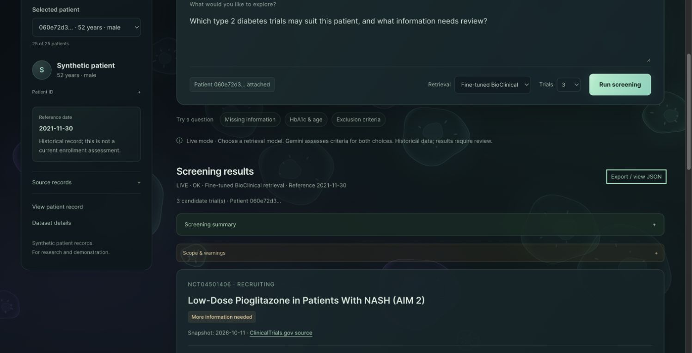

# TrialMatch

Team: **Orange Chicken**.

TrialMatch uses synthetic patient records to find type 2 diabetes trials and review
eligibility criteria. Responses include source evidence, screening barriers and missing
information. This is a research demo, not a clinical eligibility decision.

## New since MS2

| MS3 component | Implementation and evidence |
| --- | --- |
| Training | Contrastive encoder training on Vertex AI, tracked in W&B; [successful run and reproduction](docs/ms3/evidence/module-b/2026-11-10/README.md). |
| Deployment | [Cloud Run app](https://trialmatch-15733748057.us-east1.run.app), private Chroma VM and shared GCS data. |
| Automated workflow | Four-step Vertex pipeline for data recovery, processing, validation and retrieval; [screenshots](docs/ms3/evidence/module-a/screenshots.md). |
| Monitoring and API | Structured Cloud Logging, request IDs, readiness checks and API tests; [API guide](docs/ms3/API_MONITORING.md). |
| Model comparison | Gemini or the evaluated fine-tuned encoder in the app; [retrieval benchmark](evaluation/ms3/retrieval/README.md). |
| Containers | Each image has its own Dockerfile, pyproject.toml and uv.lock. |

## Modules

| Directory | Purpose |
| --- | --- |
| `services/trial_ingestion/` | ClinicalTrials.gov data and eligibility criteria. |
| `services/patient_processing/` | Synthea FHIR records converted into patient facts. |
| `services/rag_workflow/` | Retrieval, criterion assessment and evidence validation. |
| `services/frontend/` | Web page and integrated FastAPI application. |
| `cloud/`, `docker/` | Training, Vertex pipeline, containers and deployment. |
| `evaluation/ms3/` | Separate retrieval and eligibility benchmarks. |

## Quick Start

Install Docker and make, start Docker, then run from the repository root:

```bash
make up
```

Open http://localhost:8080. Select a patient and click **Run screening**.
Offline mode uses the included data, BM25 and Python rules; it needs no Google
credentials. Unsupported or missing information remains UNKNOWN.

| Command | Purpose |
| --- | --- |
| `make up` | Start the offline app and Chroma using the processed data. |
| `make live` | Restore the Gemini index, prepare the trained encoder index and start online screening. |
| `make down` | Stop the containers and keep the saved database. |
| `make reproduce` | Restore raw trials with DVC, rebuild and verify processed files, then start the offline app. |

Compose defines three services: `trial-processing`, `rag-api` and `rag-chromadb`.
Their build files are under the matching directories in `docker/`. The backend also
serves the web page. It starts after processing finishes and Chroma is healthy.
Chroma stores its data in the `rag-chroma-data` volume at `/data`.

Python dependencies, uv and DVC run in Docker. Local Compose mounts module source
read-only and reloads backend changes; cloud images contain the code. Each service
installs only its own locked dependencies. `docker/workflow/`, `docker/trainer/` and
`docker/retrieval/` provide the separate cloud job environments.
Processed data stays in `services/`; generated files stay in ignored `artifacts/`.

## Online Screening

1. Sign in with `gcloud auth application-default login`.
2. Copy the ADC file reported by that command to `secrets/google-credentials.json`.
3. Copy `.env.example` to `.env` and set `GCP_PROJECT=trialmatch-ac215-yixiao`.
4. Run `make live`.

Your account needs access to the shared DVC/model storage and Vertex AI. `.env`,
credentials, model weights and local caches stay out of Git.

Choose **Gemini** or **Fine-tuned BioClinical** under **Retrieval**. Both combine
BM25 and vector search. The choice changes the embedding model and its Chroma
collection; Gemini still assesses criteria in both cases. The response identifies
the model actually used. Offline mode remains BM25 only.

The trained option uses the evaluated November 10 checkpoint at
`gs://trialmatch-ac215-yixiao-ms3/training/train-20261110-t4-r3/model`.
Its SHA256 is pinned in `services/rag_workflow/config.py`. It runs on CPU without
retraining. The first local start downloads the model and builds its index; later
starts reuse the files. Initial model loading can make the first request slower.

## API

Interactive documentation: http://localhost:8080/docs. The same routes are available
on the [cloud app](https://trialmatch-15733748057.us-east1.run.app/docs) without login.

| Endpoint | Purpose |
| --- | --- |
| `GET /health`, `GET /metadata` | Service mode and data information. |
| `GET /ready` | Check data/index readiness; no model calls. |
| `GET /patients`, `GET /patients/{patient_id}` | List patients or load a patient record. |
| `POST /screen` | Return candidate trials, assessments and source evidence. |

```bash
curl http://localhost:8080/screen -H 'Content-Type: application/json' -d \
  '{"patient_id":"060e72d3-912e-55cd-0c92-5faa6cb7a6db","question":"Which type 2 diabetes trials may suit this patient?","top_k":3}'
```

In live mode, add `"retrieval_model":"gemini"` or `"retrieval_model":"finetuned"`.
Omitting it uses the configured default, Gemini. `top_k` is 1–5. The request accepts
either `patient_id` or one normalized `patient` object, not both.

The response contains `mode`, `result_status`, `candidate_trials`, `errors`,
`provenance` and `metrics`. Each candidate includes criterion assessments and evidence.
`OK` means the request completed, not that the patient is eligible. UNKNOWN is not
negative evidence, and `match_score` is not an enrollment probability.
Use `/ready?retrieval_model=finetuned` to check the trained index specifically.
See the [RAG guide](services/rag_workflow/README.md) for the full response contract.

## Data Reproduction

With the credentials above and access to the DVC bucket, run `make reproduce`.
It restores 1,385 fixed raw trial files and rebuilds 1,313 trials and 18,456 criteria.
Both processed files must match the recorded checksums before replacing existing
files. It does not fetch new registry data or regenerate the patient cohort.

The demo uses 50 fixed trials and 25 Synthea patients. Trial snapshot:
`2026-10-11`; patient reference date: `2021-11-30`.
See the [trial data guide](services/trial_ingestion/README.md),
[patient data guide](services/patient_processing/README.md) and
[index versioning guide](services/rag_workflow/INDEX_VERSIONING.md).

## Cloud Deployment and Pipeline

Project: `trialmatch-ac215-yixiao`. Region: `us-east1`.
Configuration: `cloud/config.env`.

The [cloud app](https://trialmatch-15733748057.us-east1.run.app) and API are public;
no login or local setup is needed. Screening requests use the project's model
quota. Storage buckets and cloud administration remain private. Cloud services
use attached service accounts.

Cloud Run hosts the API and page with 2 CPUs, 4 GiB memory, zero minimum instances
and one maximum instance. Chroma runs on a separate VM with a persistent data disk;
only the TrialMatch subnet can reach its port. The app restores the Gemini snapshot
and the trained encoder's separate index. Its snapshot is stored beside the model;
`cloud/setup.sh` grants creation only within that checkpoint's `indexes/` prefix.

Install Docker, the Google Cloud CLI and Python 3. Set up ADC as above, then:

```bash
gcloud auth login
bash cloud/setup.sh
make live
bash cloud/deploy.sh build
bash cloud/deploy.sh publish
bash cloud/deploy.sh database
bash cloud/deploy.sh pipeline
bash cloud/deploy.sh app
```

`setup.sh` is the one-time resource setup. `make live` obtains the saved input index.
Build records exact image digests and input hashes; publication and the pipeline use
that record. The full deployment command requires a successful matching pipeline.
The app deployment allows unauthenticated access and disables IAP login.

The default pipeline restores raw data with DVC, processes it, checks its output,
and produces BM25/Gemini rankings. Each task passes versioned files through GCS.
[Successful run](https://console.cloud.google.com/vertex-ai/locations/us-east1/pipelines/runs/trialmatch-data-pipeline-20261112024908?project=trialmatch-ac215-yixiao).
Use `bash cloud/deploy.sh pipeline --compile-only` to compile without submitting.
Training and evaluation are optional branches documented in the
[pipeline training guide](docs/ms3/module-a-training.md).

For an application-only change, build the image, then update the app using the
command below. This keeps the currently deployed data release; use the full sequence
above when data or its processing changes.

```bash
API_IMAGE=$(python3 -c 'import json; print(json.load(open("artifacts/cloud/release_target.json"))["api_image"])')
gcloud run services update trialmatch --project=trialmatch-ac215-yixiao \
  --region=us-east1 --image="$API_IMAGE" --cpu=2 --memory=4Gi
```

The Chroma VM incurs charges while it is on. Use `gcloud compute instances stop
trialmatch-chroma --zone=us-east1-b --project=trialmatch-ac215-yixiao` when it is not
needed, and `instances start` before the next demo. Stored data remains on disk.

## Training and Evaluation

MS3 fine-tunes BioClinical-ModernBERT with InfoNCE using 5,137 training pairs and
476 validation pairs. All 50 benchmark trials are excluded. The successful Vertex
job used one T4, three epochs, batch size 8, learning rate 2e-5 and seed 0.
[W&B run](https://forge.coreweave.com/wandb/jennyyang-harvard-university/trialmatch-ms3/runs/26xhkrre).

To reproduce that run, use its frozen pair files and exact trainer image. The
launcher generates a new run ID when omitted:

```bash
export GOOGLE_APPLICATION_CREDENTIALS="$PWD/secrets/google-credentials.json"
export GOOGLE_CLOUD_QUOTA_PROJECT=trialmatch-ac215-yixiao
uv run --project docker/workflow --locked python -m cloud.train_job \
  --image us-east1-docker.pkg.dev/trialmatch-ac215-yixiao/trialmatch/trainer@sha256:97c872638eabbf681d020d6bb1c1f534a707e3798b997d57ad435d7bd964fea9 \
  --pairs gs://trialmatch-ac215-yixiao-ms3/training/pairs/20261110/pairs.jsonl gs://trialmatch-ac215-yixiao-ms3/training/pairs/20261110/pairs_llm.jsonl \
  --batch-size 8 --evidence artifacts/training/reproduction
```

This launcher uses host `uv` and Python. Add `--dry-run` to inspect the job without
submitting. Vertex needs T4 quota and the pipeline service account needs access to
the `wandb-api-key` Secret Manager secret. Verify `experiment.mode=online` in the
manifest; without the key, tracking falls back to offline mode.
[Training configuration, screenshots and limitations](docs/ms3/evidence/module-b/2026-11-10/README.md).

The submitted retrieval report compares 14 saved methods using eight queries and
182 judgments. Reproduce its scores without training, cloud access or model calls:

```bash
MS3_REPORT_DIR=$(mktemp -d)
python3 evaluation/ms3/retrieval/evaluate_retrieval_complete.py \
  --output-dir "$MS3_REPORT_DIR/results"
```

The [report](evaluation/ms3/retrieval/RETRIEVAL_EVALUATION_REPORT.md) applies to its
original model, labels and query settings. Web requests use patient-aware hybrid
retrieval, so those benchmark scores do not automatically apply to every request.
The later seven-task pipeline generated a different checkpoint and stopped scoring
on ten unjudged pairs. Its failed status remains recorded separately. Training queries
are generated, the saved model is the last epoch, and no clinician validated the system.
Eligibility evaluation is separate; see [evaluation modules](evaluation/ms3/README.md).

## Monitoring and Tests

Cloud Logging records request IDs, status codes, latency, screening status and model
usage. Open Logs Explorer in the TrialMatch project and filter:

```text
resource.type="cloud_run_revision"
resource.labels.service_name="trialmatch"
jsonPayload.message="http_request"
```

Use `jsonPayload.message="screening_completed"` for model summaries or add
`jsonPayload.status_code>=400` for HTTP errors. Cloud Run also shows request and latency
metrics. [Logging fields and HTTP verification](docs/ms3/API_MONITORING.md).

Run the existing API tests inside the backend container:

```bash
docker compose exec -T rag-api python -m unittest services.rag_workflow.tests.test_api_operations -v
```

Other module tests and protocols are linked from their READMEs. Local tests and
HTTP success do not establish clinical accuracy.

## Submission Evidence

This branch contains the MS3 submission. Earlier MS2 materials remain in the
[`milestone2` branch](https://github.com/liujiaxi0301/TrialMatch/tree/milestone2).

- [Presentation slides](docs/ms3/TrialMatch-MS3.pptx).
- [Training run and W&B charts](docs/ms3/evidence/module-b/2026-11-10/README.md).
- [Vertex pipeline screenshots](docs/ms3/evidence/module-a/screenshots.md).
- [Evidence summary and evaluation provenance](docs/ms3/submission-evidence.md).
- Online verification on November 12: revision `trialmatch-b7738f4`; both retrieval
  options returned three candidates with `result_status=OK` and no recorded errors.



The submission branch is **milestone3**. Submit its full commit hash on Canvas.
