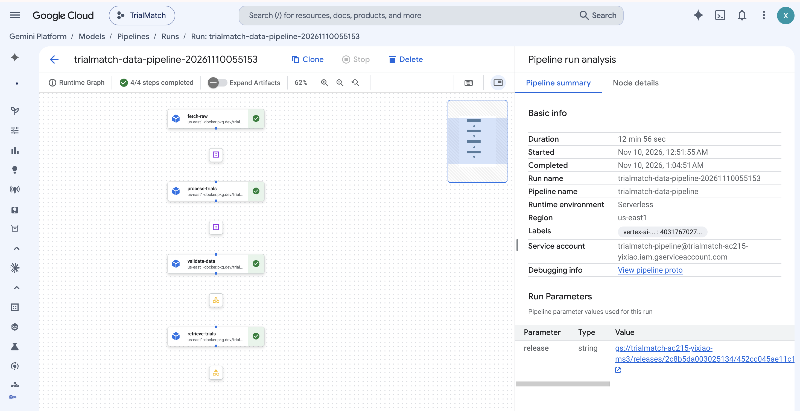

# Successful data and retrieval pipeline

Run: `trialmatch-data-pipeline-20261110055153`, November 10, 2026.
Project: `trialmatch-ac215-yixiao`; region: `us-east1`.
Recorded source: `6cae15b387cb4de2e344b49864b68f7d0b24ab6a`.

All four tasks succeeded: `fetch-raw -> process-trials -> validate-data -> retrieve-trials`.
The run restored and validated 1,313 trials, 18,456 criteria, 25 patients and
607 vectors, then produced 48 ranking records for eight queries and six methods.
It does not include encoder training or scored relevance evaluation.

## Evidence

- [Vertex job](raw/vertex-job.json): task states, configuration and artifact locations.
- [Build records](raw/matching-builds.json): recorded source and image identity.
- [Input release](raw/input-release.json), [output release](raw/output-release.json) and
  [validation](raw/validation.json): data versions and checksums.
- [Rankings](raw/retrieval_runs.jsonl) and [configuration](raw/retrieval_runs.config.json).
- [Retrieval logs](supplemental/retrieve-trials-logs.json): successful retrieval execution.

These are selected original records. Other nodes' logs were not collected.
Source identity is recorded by the build; a clean source checkout was not independently
verified. Earlier reviews and empty log exports are omitted from this submission.
