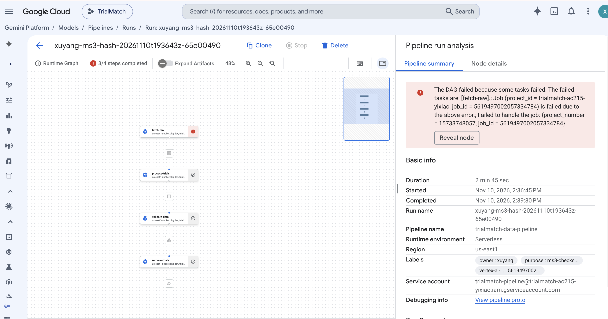

# Checksum failure blocks downstream tasks

Run: `xuyang-ms3-hash-20261110t193643z-65e00490`, November 10, 2026.
The pipeline is FAILED as expected: `fetch-raw` rejected a corrupted `raw.dvc`,
and `process-trials`, `validate-data` and `retrieve-trials` were NOT_TRIGGERED.

The test added one newline to a separate input copy while retaining its original
expected SHA256. It did not change the original data or deployed service.

## Evidence

- [Vertex job](raw/vertex-job.json): failure and downstream task states.
- [Worker logs](raw/fetch-logs-0.json):
  `ValueError: Checksum mismatch: services/trial_ingestion/data/raw.dvc`.
- [Original pointer](raw/original-raw.dvc) and [damaged copy](raw/bad-raw.dvc).
- [Baseline release](raw/baseline-release.json) and [test release](raw/bad-release.json).
- [Test result](raw/result.json): recorded checks and executor identity.

This establishes checksum rejection for the recorded four-task image, not every
failure mode or the later training pipeline. Reproduction instructions are in the
[checksum test guide](../../../module-a-cloud-failure.md).
