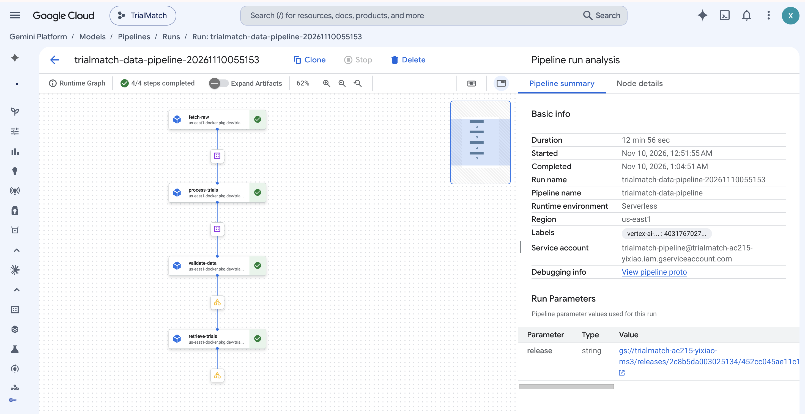
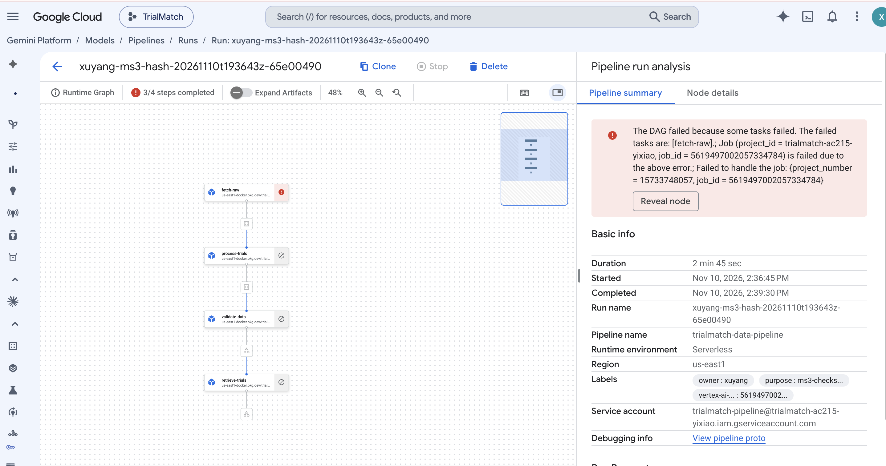
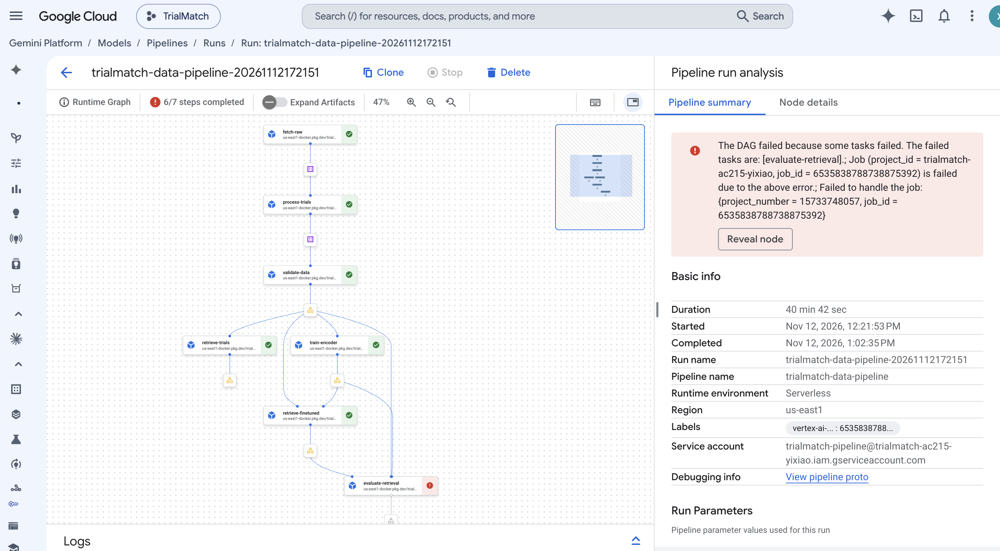

# Vertex pipeline screenshots

Original PNG files supplied by Xuyang in `screenshot.zip` on November 12, 2026.
The images are stored unchanged. Their visible run IDs and task states agree
with the archived cloud records linked below. The
[image inventory](screenshots-20261112.json) records the source ZIP checksum,
original image dimensions and individual SHA256 values.

## 1. Successful data and retrieval workflow

Run: `trialmatch-data-pipeline-20261110055153`.

All four tasks succeeded: `fetch-raw`, `process-trials`, `validate-data` and
`retrieve-trials`. The console shows 4/4 completed and a duration of 12 min 56 sec.
This run generates retrieval rankings; it does not include encoder training or
formal relevance scoring. See the [run evidence](gcp-20261110/README.md).

## 2. Checksum failure blocks downstream tasks

Run: `xuyang-ms3-hash-20261110t193643z-65e00490`.

This is the deliberately damaged-input test. `fetch-raw` failed and the three
downstream tasks were NOT_TRIGGERED. The test passed because the pipeline
rejected the damaged input and stopped. The pipeline itself remains FAILED.
The console's "3/4 steps completed" counter does not mean three tasks succeeded.

The graph shows failure and blocking; the exact checksum exception is established
by the worker logs in the [negative-test evidence](negative-20261110/README.md).
The separate checksum-error screenshot is not included in this upload.

## 3. Training and retrieval succeeded; evaluation remained incomplete

Run: `trialmatch-data-pipeline-20261112172151`.

Six tasks succeeded, including `train-encoder` and `retrieve-finetuned`.
`evaluate-retrieval` failed, so the overall pipeline remains FAILED. The console
shows 6/7 completed and a duration of 40 min 42 sec. The exported diagnostic and
logs identify ten unjudged query/trial pairs as the scoring blocker; the graph
alone shows the failed node. See the [integration evidence](gcp-20261112/README.md).

These are pipeline screenshots. The [selected submission report](../../submission-evidence.md)
uses the historical November 10 model and its matching rankings. The images do
not establish new-model evaluation scores or a deployed Cloud Run response.
