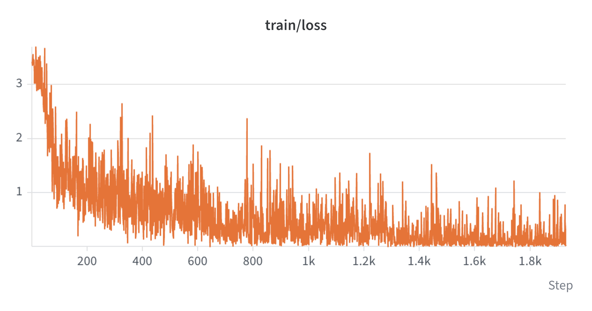
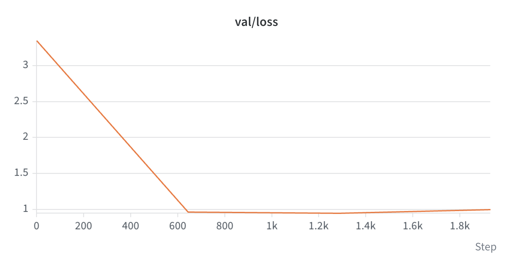

# Module B training run, 2026-11-10

One contrastive fine-tuning run of `thomas-sounack/BioClinical-ModernBERT-base` on Vertex AI.
The patients and queries in this project are synthetic or generated; nothing here is
clinically validated.

## The run that succeeded

| | |
| --- | --- |
| Vertex job | `projects/15733748057/locations/us-east1/customJobs/8919501313956380672` |
| Display name | `trialmatch-train-20261110-t4-r3` |
| State | `JOB_STATE_SUCCEEDED` |
| Machine | `n1-standard-4`, 1 x `NVIDIA_TESLA_T4`, `us-east1` |
| Image | `us-east1-docker.pkg.dev/trialmatch-ac215-yixiao/trialmatch/trainer@sha256:97c872638eabbf681d020d6bb1c1f534a707e3798b997d57ad435d7bd964fea9` |
| Image build | Cloud Build `31e6faa6-431f-431b-b503-f7ae197d39c5` |
| Code commit | `f16f3e83402a80d63ef3941849800859e496738a` |
| Checkpoint | `gs://trialmatch-ac215-yixiao-ms3/training/train-20261110-t4-r3/model` |
| Checkpoint SHA256 | `7dcec7d9c8ca3697ee60091346723130ebb37263254e81a69a0aff038dbc931c` (recomputed from GCS, matches the manifest) |
| W&B run | https://forge.coreweave.com/wandb/jennyyang-harvard-university/trialmatch-ms3/runs/26xhkrre |
| Training time | 889 s |

Configuration: 3 epochs, batch size 8, 4 hard negatives per pair, max length 256,
learning rate 2e-5, temperature 0.05, seed 0, fp16 mixed precision, `eager` attention.
Inputs: `pairs.jsonl` (2,281 pairs) and `pairs_llm.jsonl` (3,332 pairs); 5,137 training
and 476 validation pairs; none of the 50 benchmark trials, which the trainer asserts.

Files: `job.json` (job spec, state, checkpoint verification), `training_manifest.json`
(as written by the job), `job.log` (the full Cloud Logging export).

## Internal validation

386 validation queries against a pool of 1,046 passages from training-side trials. This
is not the retrieval benchmark and no benchmark query was scored.

| | val loss | Recall@10 | MRR@10 |
| --- | ---: | ---: | ---: |
| frozen | 3.348 | 0.249 | 0.147 |
| epoch 1 | 0.964 | 0.782 | 0.477 |
| epoch 2 | 0.948 | 0.802 | 0.514 |
| epoch 3 | 0.999 | 0.802 | 0.488 |

Validation loss does not fall in every epoch: it rises in epoch 3, and MRR@10 falls with
it. The saved checkpoint is the epoch-3 model, not the epoch-2 one.

Charts exported from the W&B run `26xhkrre` (steps are optimizer steps, 643 per epoch):





## The two attempts before it

- `attempt-1-failed/`: job `2476890940770353152`. The frozen encoder's validation loss was
  NaN on CUDA and training stopped at step 0. No checkpoint was written.
- `attempt-2-failed/`: job `2630787384286904320`, with a numerics check added. The check
  found the `sdpa` attention path non-finite on CUDA under the image's PyTorch 2.4 and
  the `eager` path equal to CPU within 2.4e-7, then training ran out of GPU memory at
  batch size 16. No checkpoint was written.

The third attempt changed only the batch size, from 16 to 8.

## Reproduce

```bash
python -m cloud.train_job \
  --image us-east1-docker.pkg.dev/trialmatch-ac215-yixiao/trialmatch/trainer@sha256:97c872638eabbf681d020d6bb1c1f534a707e3798b997d57ad435d7bd964fea9 \
  --pairs gs://trialmatch-ac215-yixiao-ms3/training/pairs/20261110/pairs.jsonl gs://trialmatch-ac215-yixiao-ms3/training/pairs/20261110/pairs_llm.jsonl \
  --run-id <new-run-id> --batch-size 8 --evidence <directory>
```

