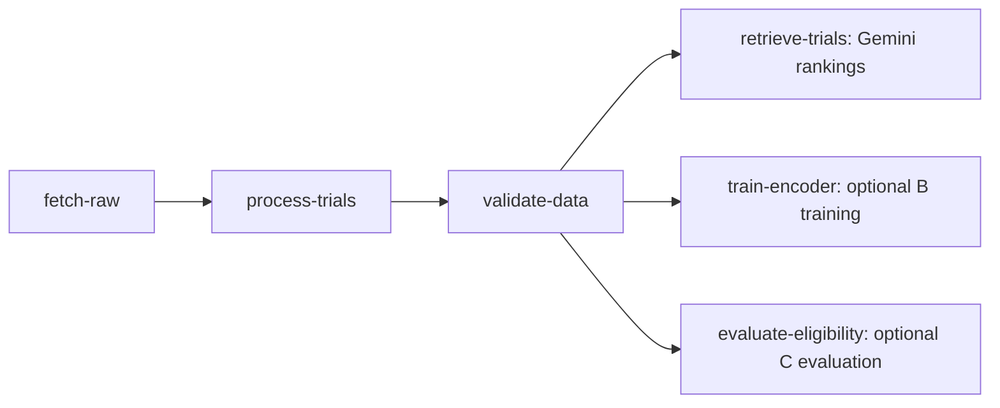

# Module A: fixed-pair eligibility integration

Status: local implementation for review, 2026-11-11. No new cloud execution is
claimed. C's files are imported unchanged from Jiaxi's `jiaxi/ms3-evaluation`
at `243f6bc6e92f8d4387b8d4ef1f7bf201083c9290`. C owns the benchmark, annotations,
inference harness and scoring. A adds cloud orchestration, artifact handling,
failure checks and CI. Jenny's pending B integration is retained separately.

## Graph and scope



The default is still four tasks. `--eligibility` adds C's task, independently of
`--trainer-image`. Enabling both produces six tasks. Eligibility consumes this
run's validation report, not B's checkpoint or retrieval rankings. It uses C's
eight fixed patient/trial pairs and 115 criteria. It evaluates MET / NOT_MET /
UNKNOWN judgments, not the trained encoder's retrieval quality. A separate
retrieval evaluation is still needed to assess B's model.

The cohort is exploratory, includes previously inspected cases, and uses
non-clinician reference annotations. Neither `official_reporting_ready` nor a
successful Vertex task establishes clinical validity or independent held-out
quality. There is no minimum accuracy/F1 gate; model-call errors are execution
failures, whereas low quality scores remain valid results to report honestly.

## Runtime contract

`cloud/eligibility.py` runs inside the workflow image. The image now includes
C's evaluator, protocol, frozen cases, cohort manifest, reviewed labels and
Developer-provider source (the latter is included in C's code-hash record).
The historical predictions, model-response caches and test outputs are not
copied into the image. No PyTorch dependency is added.

Inputs:

- `--source`: the `validate-data` output artifact URI. Its `validation.json`
  must say PASSED and name a checksummed GCS release. The report's source hashes
  must also match C's frozen cohort before inference starts.
- `--output`: this Vertex task's unique output artifact URI. Do not manually
  reuse another run's output prefix.
- `--image-uri`: full workflow image digest. Pipeline `--eligibility` requires
  `--image` pinned by SHA256; old workflow images do not contain this wrapper.
- `--model`: defaults to `gemini-3.1-flash-lite`, matching C's baseline model
  identifier. Pipeline override: `--eligibility-model`.
- `GCP_PROJECT`, `GCP_LOCATION=global`: set by the component. Gemini uses the
  pipeline service account through Vertex, not a Developer API key. This is a
  new Vertex-provider run, not reuse of C's Developer API baseline evidence.

The wrapper downloads the release using the existing checksum checks. C then
checks the actual data against its frozen cohort. Each invocation has a fresh
output/cache directory and calls `run --split all --provider vertex` through
the existing Python functions. Predictions are saved before gold-label scoring.
C's source, annotations and saved baseline remain unchanged.

Outputs under the task's GCS artifact URI:

| File | Contents |
| --- | --- |
| `all_vertex_pipeline_predictions.jsonl` | Criterion predictions |
| `all_vertex_pipeline_metadata.json` | Provider/model, input/code hashes, counts |
| `all_vertex_pipeline_metrics.json` | Scores, failures and reporting-readiness flag |
| `all_vertex_pipeline_disagreements.csv` | Disagreements and inference failures |
| `eligibility_manifest.json` | Status, input report/release, image, source commit, output URIs and SHA256 |

The wrapper requires all eight cases and 115 predictions, a matching Vertex
provider/model, zero model-call errors, matching source/prediction hashes and
`official_reporting_ready == true`. Otherwise it uploads available diagnostic
outputs with a FAILED manifest and raises, so Vertex marks the task failed.
Only the error class is added to the failure manifest/log; response caches are
not uploaded. Result files may contain synthetic patient evidence and belong in
the team's existing access-controlled evidence storage.

After a successful pipeline, the submitter binds the manifest to this task's
release/report/output/image/model, downloads all four result files, verifies
their checksums and repeats the readiness check. Only after all enabled B/C
checks pass are local success markers written. It saves
`artifacts/cloud/eligibility_manifest.json`; raw evaluation outputs stay in GCS.
Failed runs remove old local eligibility, training and data success markers.

## Commands

Local compilation only (example resources, no cloud calls):

```bash
docker/workflow/.venv/bin/python -m cloud.pipeline \
  --project trialmatch-ci --region us-east1 --bucket trialmatch-ci-data \
  --image example/workflow@sha256:eeeeeeeeeeeeeeeeeeeeeeeeeeeeeeeeeeeeeeeeeeeeeeeeeeeeeeeeeeeeeeee \
  --release gs://trialmatch-ci-data/releases/fixed/release.json \
  --eligibility --compile-only
```

Add a digest-pinned `--trainer-image` to compile the six-task variant. The
existing regression tests compile all combinations without submitting jobs.

For a future authorized cloud run, build/publish a new workflow image from the
reviewed integrated source first, using the existing release-target workflow.
Then `bash cloud/deploy.sh pipeline --eligibility` forwards the optional flag
and binds that image and release. B training is opt-in via `--trainer-image`.
Confirm the service account can invoke the selected Vertex model in `global`
and access the GCS inputs/outputs. Preserve the new job and evaluation manifest
as evidence. This document does not claim that build or cloud run has happened.

## Local verification

```bash
docker/workflow/.venv/bin/python -m unittest discover -s cloud/tests -v
docker/workflow/.venv/bin/python -m unittest discover -s evaluation/ms3/eligibility/tests -v
```

The new wrapper tests use C's real prediction/scoring code with simulated Gemini
and GCS; they are integration checks, not live model quality measurements. They
cover complete results, model errors, frozen-data mismatch, release checksum
failure, missing output and failed uploads. Pipeline checks cover five/six-task
dependencies, result tampering, foreign manifests and success-marker cleanup.
The existing CI workflow now runs C's eight regression tests as well.

Local results on 2026-11-11:

- `cloud/tests`: 86 tests, 83 passed and 3 skipped because PyTorch is absent.
  This includes 14 new eligibility task/graph regression tests.
- C's unchanged evaluation suite: all 8 tests passed. Combined: 91 passed,
  3 skipped. No real Gemini call was made.
- CLI compilation succeeded for the default four-task, eligibility-only
  five-task and combined six-task configurations. Training-only compilation is
  also covered by the pipeline regression suite.
- Ruff, shell syntax checks and `prepare_data.py` passed; data validation still
  reports 1,313 trials and 18,456 criteria.
- All 46 imported C files match the source commit byte for byte, including the
  frozen labels, baseline outputs and scoring implementation.

Image rebuilding, live Vertex model access and actual cloud execution remain
unverified. GitHub Actions has not run for these uncommitted changes. The
subsequent [training-input update](module-a-training.md) adds expected-hash
checks for extra training pairs; its test results are recorded separately.
Shared candidate texts do not by themselves establish benchmark leakage or
block importing B's code.
