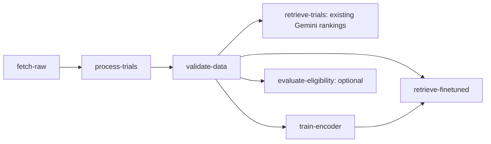

# Module A: rankings from the current training run

Status: local implementation for review, 2026-11-11, on top of `6053b7d`.
Jenny owns `evaluation/ms3/run_retrieval.py` and the trained encoder. A reuses
that entry point and adds the Vertex dependency, verified inputs, isolated
runtime, GCS outputs and failure checks. Jessie's retrieval labels and scoring
are not prerequisites for producing these rankings. The subsequent local
[`--retrieval-evaluation` integration](module-a-retrieval-evaluation.md) now adds
scoring of these current-run outputs using C's frozen bundle; cloud verification
remains pending.

## Execution graph



`--finetuned-retrieval-image` enables the new node and requires `--trainer-image`.
Both must use complete `@sha256:...` image references. No extra node is added
without this flag: the existing default/training/eligibility combinations keep
their behavior. Training plus new-model retrieval has six tasks; adding
eligibility gives seven. A training failure prevents `retrieve-finetuned` from
running. Eligibility remains independent of the encoder and its rankings.

## Input and output contract

The new node consumes **this run's** `validate-data.report` and
`train-encoder.training` artifacts. It does not default to Jenny's historical
checkpoint or to a local `training_manifest.json`.

Before ranking it:

1. Checks the PASSED report and binds training metadata to that data release,
   this task's model URI, the selected trainer image, batch size and expected
   extra-pair hashes. The same verifier is shared with the Pipeline submitter.
2. Downloads the release with the existing file checksum checks, then matches
   the loaded data hashes to the report. The benchmark manifest is also verified
   against its release checksum; the universe has 50 trials and queries Q01–Q08.
3. Downloads the checkpoint into a fresh temporary cache and verifies its actual
   file-content digest using Jenny's existing `resolve_checkpoint` function.
4. Calls `evaluation.ms3.run_retrieval` with an empty `--encoders` list and the
   explicit `--finetuned-manifest` and verified `--finetuned-checkpoint` paths.
   This selects the new model without requiring the frozen BioClinical snapshot.

The existing script emits BM25 and fine-tuned dense/hybrid rankings for both
question and patient query construction: **8 queries × 6 methods = 48 rows**,
with up to five trial IDs per row. No relevance label is read and no score is
computed. Method definitions, query construction and Jenny's script are unchanged.
Fresh local indices are isolated from the shared Chroma service. Model loading
uses the downloaded checkpoint with Hugging Face online downloads disabled.

Outputs under the new task's GCS artifact URI:

| File | Contents |
| --- | --- |
| `retrieval_runs.jsonl` | Ranking rows for C's later scoring |
| `retrieval_runs.config.json` | Jenny's method config, data/query hashes and model provenance |
| `finetuned_retrieval_manifest.json` | Input report/release, training-manifest URI/hash, checkpoint URI/hash, images, query/universe identity, output URIs/hashes |

The wrapper rejects missing/duplicate query-method rows, foreign trial IDs,
different model provenance and inconsistent data/query versions. It publishes
the success manifest only after uploading both checked output files. A model
load, retrieval, validation or upload error makes the task fail. Vertex logs
retain the exception; no success manifest is generated for that new output URI.

The submitter independently binds the output manifest to this run, verifies
both downloaded result checksums and checks their contents before writing any
local success markers. A failed rerun clears the previous local
`finetuned_retrieval_manifest.json` together with the existing markers.

## Image and resources

`docker/retrieval/` is a separate service environment: Python 3.12, pinned CPU
PyTorch 2.15.0, transformers 4.57.6 and the retrieval dependencies, with its own
`pyproject.toml`, `uv.lock`, Dockerfile and Cloud Build config. The CPU PyTorch
package comes from the explicit official PyTorch CPU index. The worker requests
4 CPUs and 16 GiB memory; it requests no GPU. Actual production-checkpoint
latency and memory use still need a cloud run.

Build a new workflow image containing the wrapper/shared verifier, a retrieval
image using `docker/retrieval/cloudbuild.yaml`, and a trainer version supporting
the previously added pair-hash interface. Use reviewed source, unique build tags
and resolved digests. Existing historical images cannot be assumed to contain
these additions. This change does not publish images or deploy a service.

## Local compilation

Example references below are placeholders for compilation only:

```bash
docker/workflow/.venv/bin/python -m cloud.pipeline \
  --project trialmatch-ci --region us-east1 --bucket trialmatch-ci-data \
  --image example/workflow@sha256:eeeeeeeeeeeeeeeeeeeeeeeeeeeeeeeeeeeeeeeeeeeeeeeeeeeeeeeeeeeeeeee \
  --release gs://trialmatch-ci-data/releases/fixed/release.json \
  --trainer-image example/trainer@sha256:dddddddddddddddddddddddddddddddddddddddddddddddddddddddddddddddd \
  --finetuned-retrieval-image example/retrieval@sha256:aaaaaaaaaaaaaaaaaaaaaaaaaaaaaaaaaaaaaaaaaaaaaaaaaaaaaaaaaaaaaaaa \
  --compile-only
```

The guarded extra-pair and W&B parameters remain as documented in
[training integration](module-a-training.md). Existing
`cloud/deploy.sh pipeline` forwards the new flag through its normal release/image
binding. Compiling does not start training, retrieval, or deployment.

## Verification and remaining work

The regression tests exercise real release/checkpoint digest verification,
Jenny's actual CLI parsing/output contract with synthetic retrieval providers,
current-run wiring and success-marker cleanup. They use synthetic queries and
IDs; held-out benchmark results are not inspected or tuned.

The separate CPU CI job uses the locked retrieval environment and constructs a
small random ModernBERT checkpoint locally to test real loading and normalized
embedding inference without downloading a model. This establishes runtime
compatibility only, not trained-model quality or performance. It does not train
on benchmark data.

Local results on 2026-11-11:

- Cloud regression suite: 116 tests, 112 passed and 4 skipped in the lightweight
  workflow environment (3 training/PyTorch checks and the new CPU runtime check).
- C's unchanged eligibility suite: all 8 passed.
- Locked CPU retrieval environment: all 11 task/runtime checks passed, including
  real loading and inference on the synthetic checkpoint. The actual Jenny CLI
  is also exercised with synthetic retrieval providers and no frozen snapshot.
- Compiled default and optional configurations passed, including six tasks with
  training/new-model retrieval and seven with eligibility as well.
- Ruff, whitespace checks and the shared helper's Python 3.10 syntax check passed.
- The local retrieval image built successfully. A temporary Dockerfile copy added
  only build-time CA-secret mounts for this managed environment's HTTPS proxy;
  the checked-in Cloud Build Dockerfile is unchanged by that trust setup. All
  11 task/runtime checks then passed inside the image with network access disabled.
- Jenny's training/ranking implementation and C's evaluator/labels are unchanged.

The new CI job is prepared but has not run on GitHub for these uncommitted
changes. No registry image was published and no Vertex job was submitted.
Production checkpoint latency, memory use and integrated cloud artifacts remain
to be verified.

Next: review and commit the implementation, build/publish the reviewed images,
run the integrated Vertex graph, and archive the actual outputs. The optional
evaluation node consumes the ranking file plus config/manifest; incomplete
judgments block scoring with a diagnostic. Ranking generation alone makes no
retrieval-score or clinical-quality claim.
