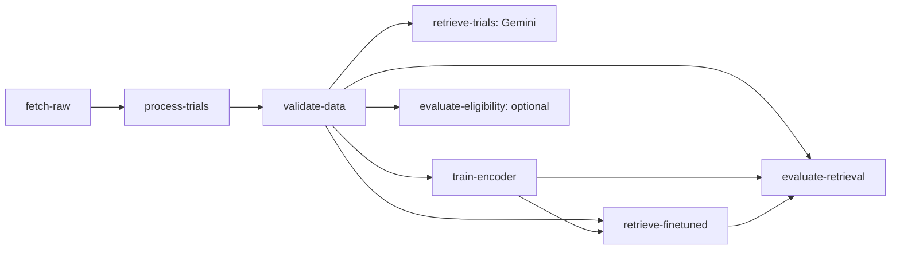

# Module A: current-run retrieval evaluation

Updated 2026-11-12 (ET): the integrated Vertex run reached scoring and stopped on
ten unjudged pairs; six preceding tasks succeeded. See the
[cloud evidence](evidence/module-a/gcp-20261112/README.md). The selected submission
results are C's existing 14-method report, reproduced from its original saved
rankings and 182 labels. See [reproduction and version mapping](submission-evidence.md).
The November 12 checkpoint has no completed retrieval scores. This decision does
not replace the inputs of the current-run adapter or suppress its missing-label guard.

## Ownership and preserved evidence

Module C (Jiaxi/Jessie) supplied the scorer, reviewed pooled judgments, fixed
queries, historical rankings and report in commit
`da3129766e77e35a646740ad0753bd90ebc6b0c4`. All 30 files under
`evaluation/ms3/retrieval/` are imported byte-for-byte. Her original scorer still
reproduces all four official output files. Its 14-method report describes the
saved runs and is separate from new pipeline results.

Module A adds `cloud/retrieval_evaluation.py`, Vertex wiring, provenance checks,
failure handling and regression tests. It calls C's existing `score()` and uses
her development/reporting scopes; it does not change relevance judgments,
metric formulas, Jenny's training or ranking methods.

The original `evaluation/ms3/retrieval_queries.jsonl` path is retained for
existing Dockerfiles and Jenny's entry point. The frozen-benchmark check requires
its bytes to match C's moved copy. No teammate branch is changed by this local import.

## Graph and enablement



Add `--retrieval-evaluation` to the existing command using `--trainer-image` and
`--finetuned-retrieval-image`. The workflow image must also be pinned by its full
digest. These flags produce seven tasks, or eight with `--eligibility`. Without
the new flag all existing configurations keep their task counts and behavior.
The original Gemini retrieval branch remains part of the graph. Eligibility
remains independent of training and retrieval relevance scoring.

The new task uses the workflow image with 1 CPU and 2 GiB memory. It loads no
model, calls no model API and requests no GPU. Its only cloud I/O is GCS.
Rebuild the workflow image to include the adapter and the frozen C bundle.
The separate retrieval image retains its current Dockerfile and dependencies.

## Binding and scoring

`cloud/retrieval_benchmark.json` pins C's source commit, scorer, label CSV,
eight reviewed-label JSON files, queries, fixed trial manifest and source-data
hashes. The submitter passes the catalog SHA256 to the task; a different image
bundle or altered file fails before scoring. Updating labels requires a reviewed
new benchmark version rather than silently editing the current bundle.

The task consumes this run's data report, training artifact and retrieval
artifact. It reuses the existing verifiers to check the report, selected trainer,
pair hashes, training output URI, model digest, ranking config, file hashes and
all 48 query-method rows. Dataset, query and trial-manifest hashes must match
the frozen evaluation benchmark. This prevents an unrelated ranking file or
historical checkpoint from being scored as the current run.

Only the current six methods are scored: BM25 and fine-tuned dense/hybrid, each
with question-only and patient-aware queries. Each query may return zero to five
distinct trials, as allowed by C's protocol. P@3 retains denominator 3; missing
positions do not receive invented trial IDs. nDCG@5 uses C's graded gain and
the ideal ordering over all judged candidates for that query.

No frozen-model delta is produced in this first integration. Such a comparison
needs the four frozen BioClinical rankings as explicit, version-checked reference
inputs with their historical provenance. C's original four comparisons remain
available in her unmodified report; they are not relabeled as this run's results.

## Outputs and failure behavior

The new task's unique GCS artifact directory contains:

| File | Meaning |
| --- | --- |
| `retrieval_per_query.csv` | 48 rows: 6 methods × 8 queries |
| `retrieval_summary.csv` | 18 rows: 6 methods × development, reporting and all-query scopes |
| `retrieval_evaluation_manifest.json` | Current report/release/model/ranking identities, image digests, benchmark/source/scorer/label hashes and output URIs/checksums |

The manifest's `PASSED` means scoring completed consistently. A low or zero
quality score is a valid result, not an execution failure. This small pooled,
AI-assisted and non-clinician benchmark does not establish clinical accuracy.

If a new model returns an unjudged query-trial pair, the task writes only
`unjudged_pairs.json` with status `BLOCKED_UNJUDGED`, then raises an error. No
metrics or success manifest are published. C can review the missing candidates
without treating absent labels as zero. A new label version may change the ideal
ranking denominator, so comparison methods must be rescored against that same
version. Do not tune retrieval against Q03–Q08 to avoid missing judgments.

Input/version, computation or upload failures propagate to Vertex. The task
publishes its success manifest last. Use new artifact directories for every run;
Vertex generates these automatically. Partial files from a failed upload are not
success evidence.

After Vertex succeeds, the submitter checks the returned manifest and downloads
both metric files. It independently recomputes the expected scores from the
verified current rankings and frozen labels and compares the exact CSV bytes.
Only after every enabled check passes are local success records written. Failed
reruns clear the previous retrieval-evaluation marker along with the existing
training, retrieval and deployment markers.

## Verification

Focused checks cover current-run wiring, disabled/default compatibility, pinned
versions, missing labels, short/empty rankings, poor scores, corrupted/missing
outputs, forged metrics with matching hashes, upload failure and success-marker
cleanup. Synthetic inputs are used for new scoring tests. C's original command
is rerun only for automated byte comparison, without inspecting held-out scores.

Run from the repository root:

```bash
docker/workflow/.venv/bin/python -m unittest cloud.tests.test_retrieval_evaluation cloud.tests.test_pipeline -v
docker/workflow/.venv/bin/python -m unittest discover -s evaluation/ms3/retrieval/tests -v
```

Local verification on 2026-11-11 (ET):

- Cloud regression: 133 tests, 129 passed and 4 skipped in the lightweight
  environment (the existing PyTorch-dependent checks).
- C's retrieval tests: 6 passed; eligibility tests: 8 passed.
- The four original retrieval outputs reproduce byte-for-byte. All 30 imported
  C files match `da31297`; Jenny's training and ranking implementations are unchanged.
- The updated workflow image builds, verifies its packaged benchmark and passes
  53 pipeline/scoring checks with networking disabled. The local build used only
  temporary CA-secret mounts for the environment proxy; no CA change is committed.
- The retrieval Dockerfile, lock and copied runtime sources are unchanged from
  the preceding successful retrieval-image verification. A fresh redundant build
  in this turn exhausted the environment's 32 GiB filesystem. Failed-build cache
  records were removed and the existing verified image retained; no new retrieval
  build success is claimed for this turn.
- Ruff, syntax and whitespace checks pass. No cloud job, registry publication,
  Git commit or push was performed for this implementation.

Subsequent execution at `96a1ab9`: the three image builds succeeded and the
seven-node Vertex graph ran on November 12. Its final scoring task failed with
`UnjudgedResults` for ten pairs. Metadata, ranking outputs and the diagnostic are
archived separately; there are no scoring CSVs or scoring success manifest for
that run. Completing its evaluation requires reviewed additional labels and a
new benchmark version. That work is deferred for the selected submission, which
uses the unchanged historical report. The original failed run is not relabeled
as successful, and no replacement training job is requested.
