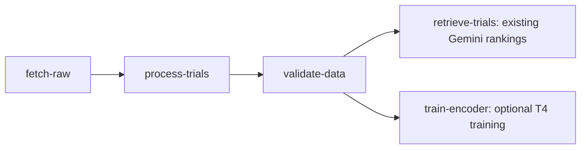

# Module A: optional training integration

Status: local integration for review, 2026-11-11. Baseline A is `132668e`; the
incoming implementation and independent training evidence belong to Jenny's
`jenny/ms3-training` at `55e88ba`. This work has not submitted a cloud job.

## Execution graph



Without either optional flag, the original four tasks remain. With `--trainer-image`, the fifth
task consumes the validation report, downloads its checksummed data release,
generates corpus training pairs and writes a model and `training_manifest.json`
under its own Vertex output artifact URI. Both consumers require validation to
succeed; neither uses an all-upstream-completed trigger. Pipeline caching remains
disabled.

Subsequent local integration adds an independent `--eligibility` branch for C's
fixed-pair evaluator. Enabling both flags produces six tasks. See
[module-a-eligibility.md](module-a-eligibility.md); C's eligibility task does not
use the new checkpoint or evaluate its retrieval quality.

## Inputs and outputs

| Input | Meaning |
| --- | --- |
| Existing `--image`, `--release`, optional `--release-target` | The data workflow's original image/release binding |
| `--trainer-image` | Independent trainer image, with a full SHA256 digest |
| `--trainer-batch-size` | Defaults to 8; Jenny's T4 run exhausted memory at 16 |
| `--train-pairs` | Optional additional GCS pair files, such as the frozen LLM pairs |
| `--train-pairs-sha256` | One expected SHA256 per extra URI, in exactly the same order |
| `--wandb-secret` | Full Secret Manager version resource, supplied to the trainer |

Corpus pairs are generated from this run's validated release. Do not also pass
the old corpus `pairs.jsonl` as an extra: doing so would duplicate those samples.
Every extra URI now requires its expected SHA256. Missing, malformed, duplicate
or mismatched URI/hash lists fail before cloud submission. The hashes must come
from reviewed version records, fixed before the run. The trainer checks the
downloaded bytes against those expectations before parsing pairs or importing
the model libraries. It parses exactly the bytes it hashed, and records both
`sha256` and `expected_sha256` for every extra source in `pair_files`.

After cloud completion, the submitter requires the generated source from this
run's release plus exactly the extra sources requested, with matching expected
and actual hashes. Missing or foreign pair sources block all local success
markers, including the eligibility marker when enabled. Configuration-check
failures clear old success markers for a real invocation; `--compile-only`
preserves prior run evidence.

The generated corpus pairs still derive from the validated release. Their
`expected_sha256` is null because no externally supplied pair file is used;
their actual checksum is recorded. SHA256 verifies file identity, not the
clinical quality of the pairs or their semantic correspondence to a release.

### Reviewed extra input and image compatibility

Jenny's checked-in `2026-11-10/training_manifest.json` records this LLM input:

```text
URI: gs://trialmatch-ac215-yixiao-ms3/training/pairs/20261110/pairs_llm.jsonl
SHA256: 94ae0f0193b2a7715625d4227c76d1cbfacce8ef0b2b53faa3b449e77d93994c
```

That historical record supplies the expectation; the current remote object has
not been downloaded or verified in this local change. If the cloud bytes differ,
investigate the difference and approve a new input version explicitly. Do not
replace the expected hash automatically with the newly downloaded hash.

Both the **workflow image and trainer image must be rebuilt** from the reviewed
integration source for this interface. The workflow forwards `--pairs-sha256`
to `cloud.train`. Jenny's historical trainer digest ending `...d964fea9` does
not implement that argument; it must not be used for this guarded extra-input
run. Its historical success evidence remains valid for its original code.

Standalone `cloud.train` calls without `--validated-report` keep the old optional
hash behavior for compatibility: they may use `--pairs-sha256`, but omitting it
records `expected_sha256: null` and provides no expected-hash guarantee. The
existing standalone `cloud.train_job` launcher is unchanged. Pipeline extra
inputs cannot opt out of the check.

The trainer uses its own image and optional dependency groups. The workflow
image gains no PyTorch dependency. The default training config remains three
epochs, learning rate 2e-5, temperature 0.05, max length 256, four hard negatives
and seed 0; the component explicitly overrides batch size to 8. The trainer
selects the numerically verified attention path at runtime.

Use `--wandb-secret projects/<project>/secrets/wandb-api-key/versions/<version>`
for online tracking. The service account needs access to that secret. B's
trainer can fall back to offline tracking, so inspect `experiment.mode` in the
result; a completed training task alone does not prove W&B received a run.

After cloud completion, the submitter checks the training manifest's schema,
workflow type, source release, image, model output URI, aggregate checksum
metadata, batch size and pair input identities. Only then does it save `training_manifest.json`,
`validation.json`, `validated_release.txt` and, for a bound build,
`validated_deployment.json`. Missing, foreign or invalid training metadata must
not leave earlier success markers. The current check does not download model
weights; the checkpoint consumer must verify the bytes before using them.

## Local checks

Run from the repository root with the workflow environment:

```bash
docker/workflow/.venv/bin/python -m unittest discover -s cloud/tests -v

docker/workflow/.venv/bin/python -m cloud.pipeline \
  --project trialmatch-ci --region us-east1 --bucket trialmatch-ci-data \
  --image example/workflow:ci \
  --release gs://trialmatch-ci-data/releases/fixed/release.json \
  --trainer-image example/trainer@sha256:dddddddddddddddddddddddddddddddddddddddddddddddddddddddddddddddd \
  --trainer-batch-size 8 \
  --train-pairs gs://trialmatch-ci-data/training/pairs_llm.jsonl \
  --train-pairs-sha256 cccccccccccccccccccccccccccccccccccccccccccccccccccccccccccccccc \
  --wandb-secret projects/trialmatch-ci/secrets/wandb-api-key/versions/1 \
  --compile-only
```

These example resources are for local compilation only. Keep `--compile-only`;
they do not identify runnable cloud artifacts. The spec is written to
`artifacts/cloud/pipeline.yaml`. Tests compile four-, five- and six-task graphs,
check image separation and T4 configuration, and simulate successful, failed,
unavailable and mismatched training outputs without cloud calls.

Latest local verification on 2026-11-11, including eligibility and the
expected-pair-hash checks:

- `cloud/tests`: 99 tests, 96 passed and 3 PyTorch-dependent tests skipped.
- C's eligibility tests: 8 passed. Combined total: 104 passed, 3 skipped.
- The hash change adds 13 tests covering argument validation, changed downloaded
  bytes, hash/parse consistency, source ordering and rejected output manifests.
- The CLI compiled the six-task graph with training, pinned extra pairs and
  eligibility enabled. No cloud submission was made.
- Ruff checks passed; the trainer and shared input helper also passed Python
  3.10 syntax parsing. A trainer image build, GPU execution and a Vertex run
  remain unverified for this change.

Initial training-integration verification on 2026-11-11, before the subsequent
eligibility and expected-pair-hash changes, using Ruff 0.17.1:

- `cloud/tests`: 72 tests, 69 passed and 3 PyTorch-dependent tests skipped.
- Encoder-provider and retrieval-metric tests: 10 tests, 6 passed and 4 skipped
  because PyTorch is absent. No model download or GPU test was performed.
- Ruff on the pipeline, tasks, release helper and `cloud/tests`: passed.
- `bash -n cloud/deploy.sh cloud/setup.sh`: passed.
- `prepare_data.py`: validated 1,313 trials and 18,456 criteria.
- Both CLI compilation variants completed: four tasks without training, five
  with training. The fifth task uses its own image, one T4 and batch size 8.
- These are local results for the pending merge, not GitHub Actions results or
  evidence that the integrated graph has run on Vertex.

## Remaining work

- No new-model retrieval task is connected yet. `retrieve-trials` continues to
  produce Gemini rankings, independent of the training output. The next step is
  to consume this run's model manifest, verify its checkpoint and generate new
  rankings in an environment with the required model dependencies.
- C's fixed-pair evaluator is now connected in the separate optional eligibility
  integration linked above. Formal retrieval scoring remains pending.
- The five-task pipeline has not been run on Vertex. Jenny's two successful
  CustomJobs remain separate evidence. Their `source_release_uri` is null;
  they must not be presented as outputs of this integrated data pipeline.
- B's negative mining shares candidate texts across the train/validation anchor
  trial split. Inspection of the current templated pairs found 29 training
  negative texts originating only from validation trials, including one text
  also used as a validation positive. Shared candidate documents can be valid
  for retrieval evaluation with held-out queries; this observation alone does
  not establish benchmark leakage or invalidate the model. B's internal
  validation uses generated pairs split by trial-ID hash (default validation
  share 10%); Jessie's manually annotated benchmark is a separate evaluation.
  Report this split accurately and avoid claiming complete trial-text isolation.
  The fixed 50-trial benchmark is excluded by the pair generators; no leakage of
  its labels was established. This observation does not block the local merge.
- LLM query generation can still write an empty file after all requests fail.
  The trainer rejects an overall dataset lacking train or validation pairs, but
  does not require every extra pair file to be nonempty.
- Before cloud execution, select reviewed image/data versions, check extra-pair
  provenance, secret access and GPU availability, then retain the actual run and
  output artifacts. Those checks are not established by local compilation.

No deployment command is invoked by this integration. The existing Cloud Run
service, Chroma VM and teammates' remote branches have not been changed.
