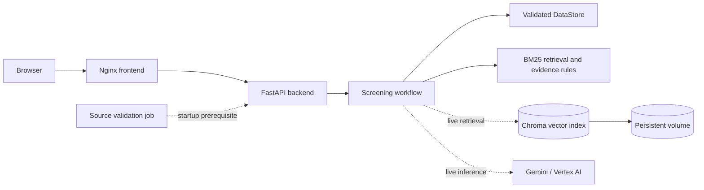
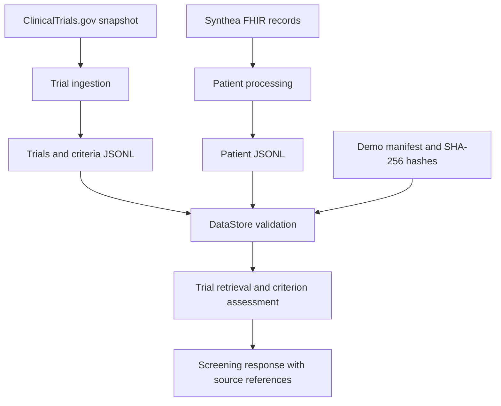

# TrialMatch — Application Design

**Team:** Orange Chicken  
**Milestone:** MS4  
**Implementation reference:** [`06ebddd`](https://github.com/liujiaxi0301/TrialMatch/commit/06ebddd46c51524e70116377f895f2e635b98875)

## 1. Purpose and user experience

TrialMatch is a research application for exploring type 2 diabetes clinical trials using **synthetic patient records**. A user selects a patient, asks a screening question, reviews candidate trials and criterion-level assessments, and traces the supporting evidence. It supports pre-screening review; it does **not** determine clinical eligibility or predict enrollment.

The reproducible demonstration contains **25 synthetic patients** and a selected subset of **50 trial records**. Offline mode uses BM25 retrieval and deterministic evidence rules without external model calls. Live mode can use Gemini or the fine-tuned BioClinical retrieval encoder with a configured vector index, with Gemini available for criterion interpretation.

### Interface layout

The current browser interface separates patient context from screening and evidence review:

```text
+----------------------------+---------------------------------------------------+
| Patient context            | Trial screening                                   |
|                            |                                                   |
| Search / select patient    | Screening question                                |
| Patient summary            | Trial count (1–5)  [Retrieval: live mode]         |
| View patient record        |                           [ Run screening ]       |
| Dataset details            |                                                   |
|                            | Mode / status / validation message                |
|                            | Candidate trial cards                            |
|                            |   Screening status and summary                   |
|                            |   Expandable criteria and source evidence        |
|                            |   Response JSON viewer / download                |
+----------------------------+---------------------------------------------------+
```

The interface also includes question suggestions, progress/status messaging and an empty-results workspace. These elements are present in [`services/frontend/static/index.html`](../../services/frontend/static/index.html); automated browser coverage is described in [Test Documentation](TEST_DOCUMENTATION.md).

## 2. System architecture

Local development uses four Docker Compose services: `trial-processing`, `rag-chromadb`, `rag-api`, and `frontend`. Nginx serves static assets at `http://localhost:8080` and forwards API requests to FastAPI; the API is also exposed at `http://localhost:8081`. The processing job validates source data before the API starts, and the API waits for a healthy Chroma service. Chroma persists data in a named volume.



| Component | Responsibility | Implementation |
| --- | --- | --- |
| Frontend / proxy | Patient selection, screening form, trial and evidence display; route proxying | `services/frontend/static/`, `docker/frontend/` |
| FastAPI | HTTP endpoints, schema validation, errors, health/readiness | `services/frontend/app.py`, `services/rag_workflow/api.py` |
| Screening | Retrieval, assessment, status aggregation and provenance | `services/rag_workflow/workflow.py` |
| Data | Load normalized files; validate identities, patient facts and checksums | `services/rag_workflow/data.py` |
| Retrieval / index | Offline BM25; optional hybrid lexical/vector retrieval and versioned snapshots | `services/rag_workflow/retrieve.py`, `index.py`, `index_versions.py` |
| Assessment | Evidence rules, optional model judgments and explicit uncertainty | `evidence_rules.py`, `judge.py`, `rules.py` |
| Runtime | Independent containers, dependency locks and persistent Chroma storage | `docker/`, `docker-compose.yml`, `Makefile` |

The existing Cloud Run deployment uses a separate single-service configuration; it is not the same as the local split-container Compose setup.

## 3. Data flow and provenance

ClinicalTrials.gov trial snapshots and Synthea FHIR records are normalized into trial, criterion and patient JSONL files. `DataStore` rejects duplicate/orphan identifiers and invalid patient facts, computes SHA-256 hashes, and verifies the selected demo manifest against the stored inputs.



The manifest identifies the 50-trial screening subset and 25 patient IDs. Responses preserve patient ID and reference date, trial IDs and snapshot dates, criterion IDs/text/types, evidence `fact_id`s and source-file hash provenance. These references allow screening outputs to be checked against source records.

The synthetic patient reference date (**2021-11-30**) differs from the trial snapshot date (**2026-10-11**); results are historical demonstrations, not current recruitment recommendations.

## 4. Screening request sequence

```mermaid
sequenceDiagram
    actor User
    participant UI as Browser
    participant Proxy as Nginx
    participant API as FastAPI
    participant WF as ScreeningWorkflow
    participant DS as DataStore
    participant RET as Retriever
    participant Judge as Rules / Gemini

    User->>UI: Select patient and enter question
    UI->>Proxy: POST /screen
    Proxy->>API: Forward HTTP request
    API->>WF: ScreenRequest
    WF->>DS: Load patient and selected trial records
    DS-->>WF: Patient facts, criteria and source hashes
    WF->>RET: Rank candidate trials
    alt Offline
        RET-->>WF: BM25 results
        WF->>Judge: Apply rules; abstain if unsupported
    else Live
        RET-->>WF: Hybrid BM25 / vector results
        WF->>Judge: Apply rules and optional Gemini judgments
    end
    Judge-->>WF: Criterion assessments with evidence IDs
    WF-->>API: ScreenResponse with provenance and warnings
    API-->>Proxy: HTTP / JSON
    Proxy-->>UI: HTTP / JSON
    UI-->>User: Display trials, criteria and evidence
```

Each criterion may be `MET`, `NOT_MET`, or `UNKNOWN`. Trial-level outcomes include `SCREENING_BARRIER`, `NEEDS_MORE_INFORMATION`, and `POTENTIAL_MATCH_FOR_REVIEW`. Missing evidence is not interpreted as a negative clinical finding. A candidate's match score summarizes assessed criteria and is not an enrollment probability.

## 5. API contract

| Endpoint | Function |
| --- | --- |
| `GET /health` | Data/application health; does not verify cloud-model access |
| `GET /ready` | Data and retrieval-index readiness checks |
| `GET /metadata` | Dataset counts and source hashes |
| `GET /patients` | List synthetic patients |
| `GET /patients/{patient_id}` | Return one normalized patient record |
| `POST /screen` | Retrieve trials and return criterion-level screening assessments |
| `POST /retrieve` | Separate local vector-demo retrieval endpoint |

**Screening request:** Exactly one of `patient_id` or normalized inline `patient`; a nonblank `question`; `top_k` between 1 and 5; and optional `retrieval_model` (`gemini` or `finetuned` in live mode).

**Screening response:** `run_id`, patient identity/reference date, `result_status`, `candidate_trials`, `warnings`, `errors`, `provenance`, and `metrics`. Candidate results contain status, criteria, evidence, missing information, warnings and trial source URLs. Request validation uses HTTP 422; missing patients use 404; unavailable data/dependencies can return 503; timeouts can return 504. Workflow results distinguish `OK`, `PARTIAL`, `ERROR`, and `NO_CANDIDATES` where applicable.

**Source of truth:** [`schemas.py`](../../services/rag_workflow/schemas.py), [`api.py`](../../services/rag_workflow/api.py), and [`app.py`](../../services/frontend/app.py). The local API exposes interactive documentation at `http://localhost:8081/docs` after startup.

## 6. Design decisions and limitations

| Decision | Reason |
| --- | --- |
| Separate browser frontend and API | Tests the actual HTTP boundary and isolates presentation from screening logic |
| Default offline mode | Reproducible local operation without model credentials or paid calls |
| Preserve source IDs, timestamps and hashes | Detect stale inputs and support evidence audit |
| Keep a persistent Chroma volume | Retain vector data across container recreation |
| Return uncertainty and source evidence | Support human review instead of asserting clinical eligibility |
| Use automated CI and browser tests | Check integration and reproducibility beyond unit tests |

**Limitations:** The demonstration uses synthetic, historical data and a heuristic 50-trial subset. Offline CI does not validate live Gemini inference, external cloud availability, clinical correctness or current enrollment status. Results must be reviewed rather than treated as medical recommendations.

## 7. Implementation and reproduction

```text
services/trial_ingestion/       Clinical trial ingestion and processed trial records
services/patient_processing/    Synthea patient normalization
services/rag_workflow/          Data store, retrieval, assessment, API and tests
services/frontend/              UI, API adapter and browser tests
cloud/                          Vertex pipeline, training and release tools
docker/                         Service images and locked dependencies
scripts/ms4/                    Coverage and Chroma-persistence checks
docs/ms4/                       Design, testing and infrastructure documentation
```

From the repository root, run `make up` and open `http://localhost:8080` for the credential-free offline demo. `make down` stops services while preserving the Chroma volume. For test evidence and commands, see [Test Documentation](TEST_DOCUMENTATION.md); for dependency, runtime and live-mode instructions, see [Infrastructure](INFRASTRUCTURE.md) and the [project README](../../README.md).
