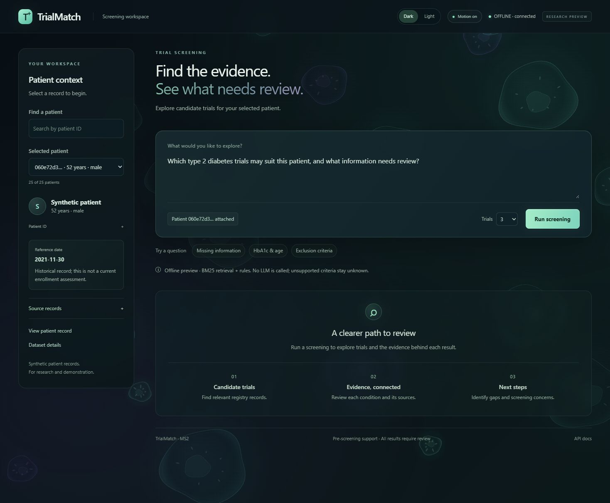
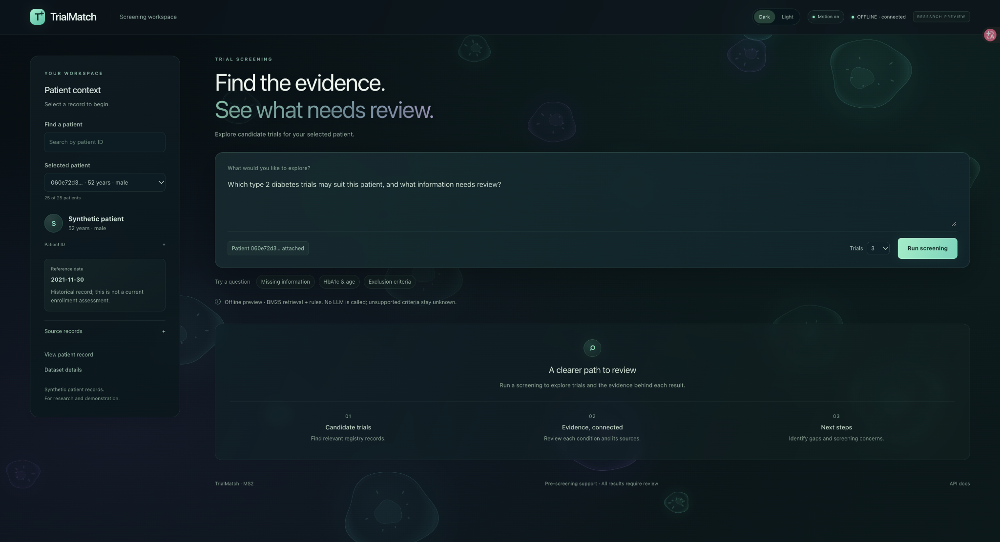
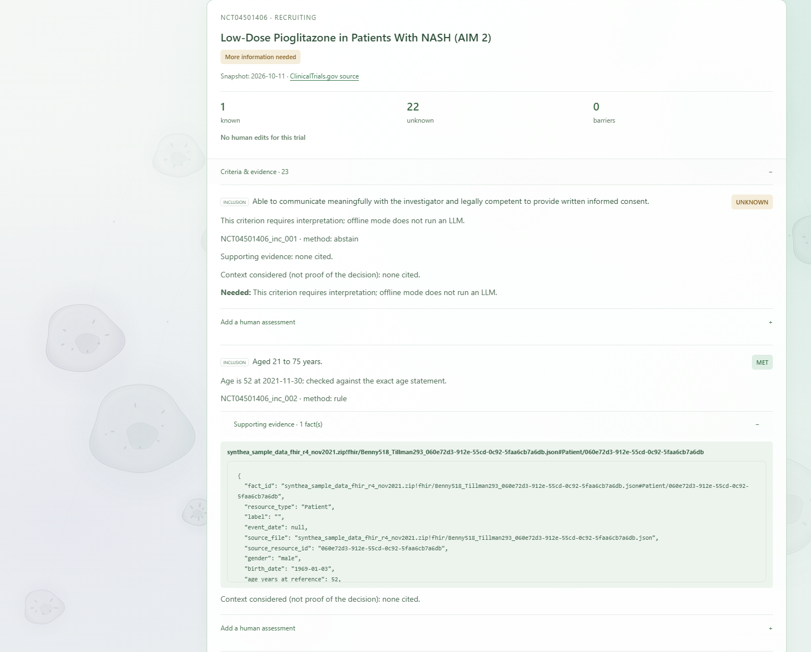
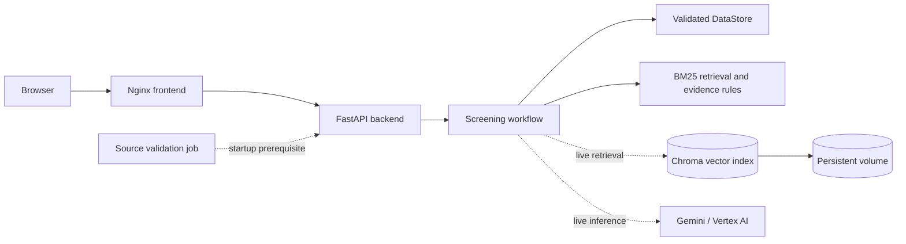
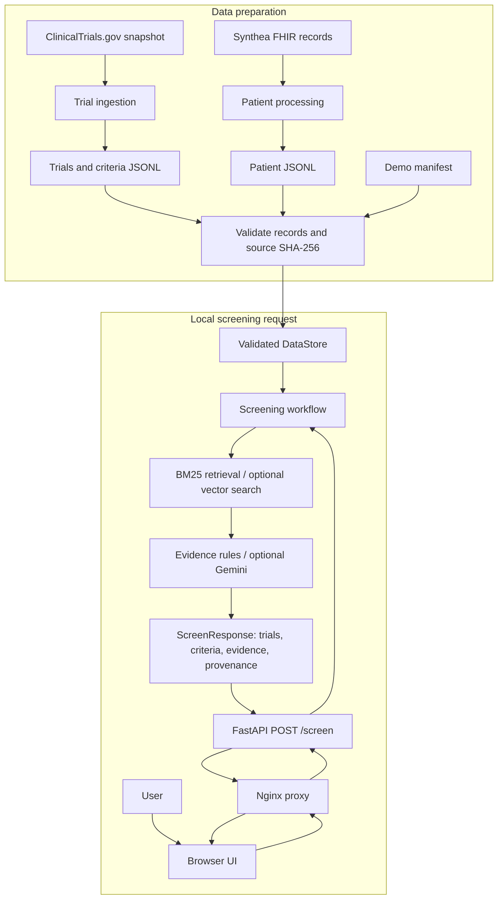
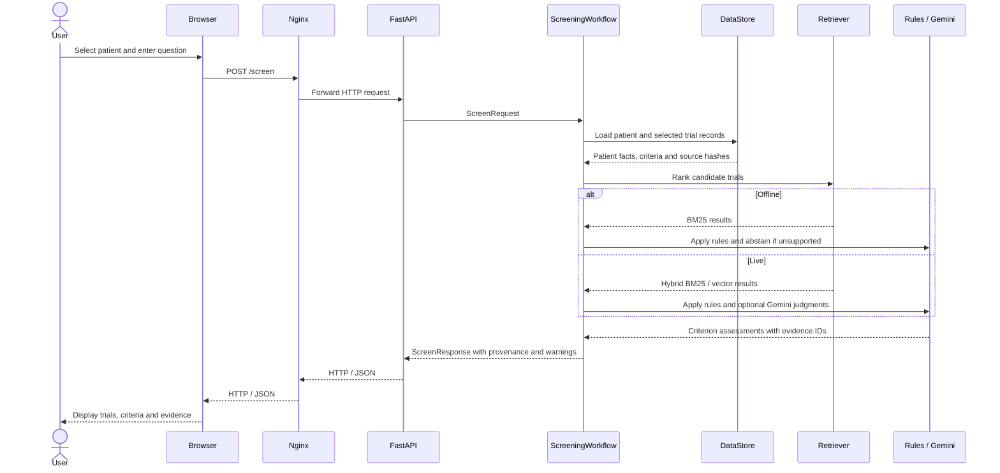

# TrialMatch — Application Design

**Team:** Orange Chicken  
**Milestone:** MS4  
**Implementation reference:** [`06ebddd`](https://github.com/liujiaxi0301/TrialMatch/commit/06ebddd46c51524e70116377f895f2e635b98875)

## 1. Purpose and user experience

TrialMatch is a research application for exploring type 2 diabetes clinical trials using **synthetic patient records**. A user selects a patient, asks a screening question, reviews candidate trials and criterion-level assessments, and traces the supporting evidence. It supports pre-screening review; it does **not** determine clinical eligibility or predict enrollment.

The reproducible demonstration contains **25 synthetic patients** and a selected subset of **50 trial records**. Offline mode uses BM25 retrieval and deterministic evidence rules without external model calls. Live mode can use Gemini or the fine-tuned BioClinical retrieval encoder with a configured vector index, with Gemini available for criterion interpretation.

### Interface design and primary user flow

The desktop interface follows the MS2 concept of keeping patient context separate from the screening workspace. It supports patient selection, screening questions, candidate-trial review, and criterion-level evidence inspection. The implemented MS4 application also provides loading indicators and visible error and empty states.

**Historical UI design (MS2).**



*Figure 1. Original MS2 interface mock-up, showing patient selection, a screening question, and the planned trial and evidence review workflow.*

**Implemented workspace (MS4).**



*Figure 2. Current MS4 local interface in offline mode before submitting a screening request.* The browser interface is available at `http://localhost:8080` in the Docker Compose setup.

**Primary user flow and screening result.** A user selects a synthetic patient and reviews the patient context, enters or selects a screening question, chooses the number of candidate trials, and runs screening. The application returns candidate trials with criterion-level `MET`, `NOT_MET`, or `UNKNOWN` decisions. The user can expand **Criteria & evidence** to review supporting patient facts and inspect the structured JSON response.



*Figure 3. Actual MS4 browser-to-API screening result in local offline mode, with a trial's criterion assessments and patient evidence expanded.* The screenshot documents an HTTP-backed local screening flow, not live-model inference or cloud deployment.

## 2. System architecture

Local development uses four Docker Compose services: `trial-processing`, `rag-chromadb`, `rag-api`, and `frontend`. Nginx serves static assets at `http://localhost:8080` and forwards API requests to FastAPI; the API is also exposed at `http://localhost:8081`. The processing job validates source data before the API starts, and the API waits for a healthy Chroma service. Chroma persists data in a named volume.



| Component | Responsibility | Implementation |
| --- | --- | --- |
| Frontend / proxy | Patient selection, screening form, trial and evidence display; route proxying | `services/frontend/static/`, `docker/frontend/` |
| FastAPI | HTTP endpoints, schema validation, errors, health/readiness | `services/frontend/app.py`, `services/rag_workflow/api.py` |
| Screening | Retrieval, assessment, status aggregation and provenance | `services/rag_workflow/workflow.py` |
| Data | Load normalized files; validate identities, patient facts and checksums | `services/rag_workflow/data.py` |
| Retrieval / index | Offline BM25; optional hybrid lexical/vector retrieval and versioned snapshots | `services/rag_workflow/retrieve.py`, `index.py`, `index_versions.py` |
| Assessment | Evidence rules, optional model judgments and explicit uncertainty | `evidence_rules.py`, `judge.py`, `rules.py` |
| Runtime | Independent containers, dependency locks and persistent Chroma storage | `docker/`, `docker-compose.yml`, `Makefile` |

**Technology choices.** The frontend uses HTML, CSS and vanilla JavaScript served by Nginx; the backend uses Python, FastAPI and Pydantic. Retrieval uses BM25 with optional Chroma-backed vector search and Gemini-based assessment in live mode. Docker Compose runs independently locked service environments, while pytest, Playwright, Ruff and GitHub Actions provide automated checks.

The existing Cloud Run deployment uses a separate single-service configuration; it is not the same as the local split-container Compose setup.

## 3. Data flow and provenance

ClinicalTrials.gov trial snapshots and Synthea FHIR records are normalized into trial, criterion and patient JSONL files. The selected demo manifest records 50 trial IDs, 25 patient IDs and source SHA-256 hashes. `DataStore` rejects duplicate or orphan identifiers and invalid patient facts, and verifies that the manifest matches the input files before screening.



Screening responses preserve patient identity/reference date, trial IDs/snapshot dates, criterion IDs/text/types, evidence `fact_id`s and source-file hashes. These allow results to be traced back to the selected input records. The synthetic patient reference date (**2021-11-30**) differs from the trial snapshot date (**2026-10-11**); the output is a historical research demonstration, not a current recruitment recommendation.

## 4. Screening request sequence



Each criterion may be `MET`, `NOT_MET`, or `UNKNOWN`. Trial-level outcomes include `SCREENING_BARRIER`, `NEEDS_MORE_INFORMATION`, and `POTENTIAL_MATCH_FOR_REVIEW`. Missing evidence is not interpreted as a negative clinical finding. A candidate's match score summarizes assessed criteria and is not an enrollment probability.

## 5. API contract

| Method | Endpoint | Request | Response |
| --- | --- | --- | --- |
| GET | `/health` | None | Service status, mode and data counts |
| GET | `/ready` | Optional `retrieval_model` | Readiness status and data/index checks |
| GET | `/metadata` | None | Dataset counts, source hashes and metadata |
| GET | `/patients` | None | Synthetic patient summaries |
| GET | `/patients/{patient_id}` | Path `patient_id` | Normalized patient record |
| POST | `/screen` | `ScreenRequest` | `ScreenResponse` with candidates, assessments, evidence and provenance |
| POST | `/retrieve` | Patient ID, question and `top_k` | Local vector-demo retrieval chunks |

`ScreenRequest` requires exactly one of `patient_id` or an inline normalized `patient`, a nonblank `question` and `top_k` from 1–5. In live mode, `retrieval_model` can select `gemini` or `finetuned`. `ScreenResponse` includes `run_id`, `result_status`, patient identity/reference date, `candidate_trials`, `warnings`, `errors`, `provenance` and `metrics`; each candidate includes criterion assessments and cited evidence. Input errors return HTTP 422, missing patients 404, unavailable dependencies 503, and timeouts 504 where applicable. A successful HTTP response is **not** a clinical eligibility determination.

The schema source is [`schemas.py`](../../services/rag_workflow/schemas.py); routes are implemented in [`api.py`](../../services/rag_workflow/api.py) and [`app.py`](../../services/frontend/app.py). Interactive OpenAPI documentation is available at `http://localhost:8081/docs` when running locally.

## 6. Design decisions and limitations

| Decision | Reason |
| --- | --- |
| Separate browser frontend and API | Tests the actual HTTP boundary and isolates presentation from screening logic |
| Default offline mode | Reproducible local operation without model credentials or paid calls |
| Preserve source IDs, timestamps and hashes | Detect stale inputs and support evidence audit |
| Keep a persistent Chroma volume | Retain vector data across container recreation |
| Return uncertainty and source evidence | Support human review instead of asserting clinical eligibility |
| Use automated CI and browser tests | Check integration and reproducibility beyond unit tests |

**Limitations:** The demonstration uses synthetic, historical data and a heuristic 50-trial subset. Offline CI does not validate live Gemini inference, external cloud availability, clinical correctness or current enrollment status. Results must be reviewed rather than treated as medical recommendations.

## 7. Implementation and reproduction

```text
services/trial_ingestion/       Clinical trial ingestion and processed trial records
services/patient_processing/    Synthea patient normalization
services/rag_workflow/          Data store, retrieval, assessment, API and tests
services/frontend/              UI, API adapter and browser tests
cloud/                          Vertex pipeline, training and release tools
docker/                         Service images and locked dependencies
scripts/ms4/                    Coverage and Chroma-persistence checks
docs/ms4/                       Design, testing and infrastructure documentation
```

From the repository root, run `make up` and open `http://localhost:8080` for the credential-free offline demo. `make down` stops services while preserving the Chroma volume. For test evidence and commands, see [Test Documentation](TEST_DOCUMENTATION.md); for dependency, runtime and live-mode instructions, see [Infrastructure](INFRASTRUCTURE.md) and the [project README](../../README.md).
