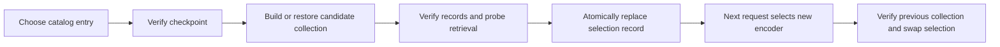

# Embeddings and index management

TrialMatch keeps each encoder's vectors in a separate Chroma collection. Switching
changes which trained encoder serves the next request, after validating its index.
MS4 adds switching and rollback; it does not retrain the model or establish new
retrieval-quality results.

## Retrieval choices

| Choice | Encoder | Vector size | Execution |
| --- | --- | ---: | --- |
| Gemini | `gemini-embedding-001` | 256 | Vertex AI |
| Fine-tuned BioClinical | Pinned BioClinical-ModernBERT checkpoint | 768 | CPU in the API container |

Both live choices combine vector search with BM25 through reciprocal rank fusion.
Both retain Gemini for criterion assessment. Offline mode uses BM25 and rules only.
The evaluated `train-20261110-t4-r3` checkpoint is the default. The catalog also
contains `pipeline-20261112`, an **unevaluated** switch demonstration target; it
requires `--allow-unevaluated` and is not a replacement quality baseline.

## Identity and isolation

`index.py` derives the collection name from a content hash of the source trial and
criterion files, trial subset, embedding model, dimension and chunking configuration.
BioClinical additionally includes the base revision, pooling, normalization, token
budget, numerical configuration and checkpoint SHA-256. A query encoder therefore
selects only the collection built for the same identity.

Before serving an index, verification checks the manifest identity, criterion IDs,
source text and metadata, vector dimensions and the checksum of every record.
Published collections are immutable. A mismatch raises an error rather than silently
repairing vectors or falling back to a different encoder.

| File | Responsibility |
| --- | --- |
| `services/rag_workflow/encoders.py` | Checkpoint catalog and active selection record |
| `services/rag_workflow/embedding_providers.py` | Encoder loading, checksum verification and pooling |
| `services/rag_workflow/index.py` | Collection identity, build, verification and retrieval |
| `services/rag_workflow/index_versions.py` | Portable snapshot schema and checksums |
| `services/rag_workflow/index_switching.py` | Validated switch and rollback |
| `services/rag_workflow/cli.py` | Operator commands |

## Switching and rollback

The selection record names the active and previous catalog entries; it does not
accept arbitrary model paths. It is written atomically only after all checks pass.
A failed build or switch leaves the previous selection unchanged. Partial candidate
collections can be reused on retry but are not served without a verified manifest.
Rollback verifies the previous collection and makes no encoder calls.

`POST /screen` and `GET /ready?retrieval_model=finetuned` resolve the selection on
each request. Readiness caches only the most recently resolved settings, so a
switch or rollback triggers a fresh check without restarting the API. A malformed
record returns `503 ENCODER_SELECTION_INVALID`; Gemini remains available. With no
selection record, the evaluated default applies.

## Storage and recovery

| Item | Local Compose location |
| --- | --- |
| Vectors | Chroma named volume `rag-chroma-data`, mounted at `/data` |
| Readiness manifests | `artifacts/infra/rag_workflow/indexes/http-<backend12>/` |
| Selection | `active-finetuned.json` in that manifest directory |
| Model cache | `artifacts/infra/rag_workflow/cache/checkpoints/<sha256>/` |
| Gemini snapshot | DVC-managed `services/rag_workflow/index_snapshots/current.json` |

Manifests and selection records are specific to each Chroma backend. Verifying an
embedded database does not make the HTTP database ready. The selection and cache
are generated state and stay out of Git.

| Failure | Behavior / recovery |
| --- | --- |
| Unknown or unevaluated target | Reject before changing selection; choose an allowed catalog entry |
| Missing or mismatched checkpoint | Reject loading; check the catalog and redownload the affected cache |
| Incomplete or incompatible index | Reject serving; restore the matching snapshot or rebuild the candidate |
| Failed candidate build or probe | Preserve the active index; fix the cause and retry |
| Invalid selection record | Return 503 for trained retrieval; inspect or move the record aside |
| Missing previous index on rollback | Preserve the current selection; restore the previous index first |

Exact commands and recovery paths are in the [index runbook](../../services/rag_workflow/INDEX_VERSIONING.md).

## Verification and limits

`make coverage` runs encoder, snapshot, switch/rollback and readiness regression
tests. `make system-test` exercises persistence and switching against the actual
Compose Chroma server, with fake encoders and disposable test collections. Live
browser verification is recorded separately in [Test Documentation](TEST_DOCUMENTATION.md).

Switching assumes one operator at a time. The selection is local state, not a
central control service. The existing Cloud Run startup restores the default index;
its local selection file is ephemeral. Persisting cloud selection and permitting
snapshot creation for additional checkpoints are outside the local MS4 scope.
