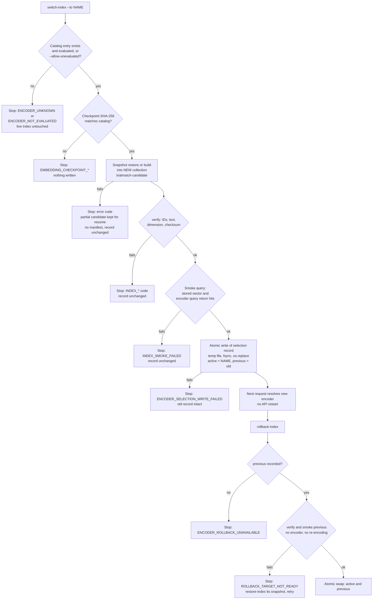

# Embeddings and Index Management (MS4 Part B)

Part B covers the retrieval encoders, the Chroma indexes built from them, and the safe
switching of the fine-tuned encoder. It shows **engineering safety**: vectors are isolated,
model versions are checked, and a failed switch can be recovered. It makes no claim about
retrieval quality or clinical accuracy. No encoder was retrained for MS4.

| Deliverable | Location |
| --- | --- |
| Encoder catalog and selection record | `services/rag_workflow/encoders.py` |
| Switch, rollback and status logic | `services/rag_workflow/index_switching.py` |
| CLI commands | `services/rag_workflow/cli.py`: `switch-index`, `rollback-index`, `index-status` |
| Automated tests | `services/rag_workflow/tests/test_index_switching.py`, plus the existing `test_index_versions.py` and `test_embedding_providers.py` |
| Migration and rollback runbook | [`services/rag_workflow/INDEX_VERSIONING.md`](../../services/rag_workflow/INDEX_VERSIONING.md) |
| Evidence | [`docs/ms4/evidence/part-b/`](evidence/part-b/) |

---

## 1. Interfaces for other parts

### 1.1 For Part C (Backend and API)

**How the API selects an index.** In the C+B integration, `/screen` resolves
`Settings.for_retrieval(request.retrieval_model)` once and shares those settings
with workflow execution and screening logs. The request field is unchanged:
`retrieval_model ∈ {null, "gemini", "finetuned"}`. See the
[API contract](API_CONTRACT.md) and the implementation in
[`api.py`](../../services/rag_workflow/api.py) and
[`workflow.py`](../../services/rag_workflow/workflow.py).

| `retrieval_model` | Encoder | Behaviour change in MS4 |
| --- | --- | --- |
| Omitted or `null` | Environment settings (normally Gemini, or BM25 only in offline mode) | None; does not read the active fine-tuned record |
| `"gemini"` | `gemini-embedding-001`, 256 dimensions | None |
| `"finetuned"` | The **active** fine-tuned encoder for this Chroma backend | Reads the selection record. Without one, the result is identical, field for field, to MS3 (`train-20261110-t4-r3`) |

**Switching does not change the API.** The routes, request schema and response schema are
unchanged. `/screen` re-reads the selection for each request; a later switch does
not change the settings already resolved for an in-flight request or its logs.
`/ready` also resolves the selection on each request and replaces its cached probe
when it observes changed settings. **No API restart is needed after switch or rollback**
with Part C's integrated lifecycle handling (see §1.4).

**`/ready?retrieval_model=…`** checks the data and manifest, then, in live mode only, the
index of the selected encoder (manifest, collection, IDs, text, metadata, dimension and
record checksum). It returns `200` when ready and `503` otherwise, with
`checks.<stage>.code`. It never calls a model.

**Error codes and bodies.** A selection-resolution failure such as
`ENCODER_SELECTION_INVALID` reaches `/screen` as
`503 {"detail": {"code": …, "message": "Screening dependency unavailable."}}`.
Provider/index failures captured inside the workflow instead appear in the full
`ScreenResponse.errors`: no candidates gives 503 `result_status="ERROR"`, while
retained results with errors give 200 `result_status="PARTIAL"`. Do not assume
every `ProviderError` uses a `detail` envelope. On `/ready`, selection failures
use `checks.encoder_selection.code`; index checks use `checks.index.code`.

| Code | Source | Trigger |
| --- | --- | --- |
| `INDEX_NOT_READY` | `index.py`, `readiness.py` | No readiness manifest for this data/model/subset/backend, or the collection is missing in this database |
| `INDEX_MANIFEST_MISMATCH` | `index.py` | The readiness manifest describes a different identity |
| `INDEX_MANIFEST_UPGRADE_REQUIRED` | `index.py` | A pre-checksum (MS2) manifest; `build-index` adds the checksum without re-encoding |
| `INDEX_INCOMPLETE` | `index.py`, `index_versions.py` | Missing, extra or duplicate record IDs, or the count differs from the manifest |
| `INDEX_SOURCE_MISMATCH` | `index.py` | Stored text or metadata differs from the source criteria |
| `INDEX_CONTENT_MISMATCH` | `index.py` | Same count but different vectors (record checksum) |
| `INDEX_CONFIG_MISMATCH` | `index.py` | The collection does not use cosine distance |
| `INDEX_CHANGED` | `index_versions.py` | The collection changed while being read |
| `EMBEDDING_DIMENSION_MISMATCH` | `index.py`, `embedding_providers.py` | A stored vector or the encoder hidden size has the wrong dimension |
| `EMPTY_INDEX` | `index.py` | No parsed criteria to index |
| `MISSING_PROVIDER` | `index.py` | A new index needs an encoder; the CLI creates one (internal to build) |
| `SNAPSHOT_CORRUPT` / `SNAPSHOT_VERSION_MISMATCH` | `index_versions.py`, `index.py` | Snapshot checksum is wrong, or the snapshot is for another identity |
| `INDEX_RESTORE_CONFLICT` / `INDEX_RESTORE_FAILED` | `index.py` | The target holds different records, or restored records do not match |
| `EMBEDDING_CHECKPOINT_MISSING` / `EMBEDDING_CHECKPOINT_MISMATCH` | `embedding_providers.py` | Checkpoint directory missing, or its SHA-256 differs from the catalog |
| `EMBEDDING_INPUT_TOO_LONG` / `INVALID_EMBEDDING` / `EMBEDDING_CACHE_MISMATCH` | `embedding_providers.py` | Encoder input or output fails validation |
| **`ENCODER_SELECTION_INVALID`** (new) | `encoders.py` | The selection record is unreadable, malformed, or names an encoder that is not in the catalog. **Never** falls back to the default silently |
| `MISSING_GCP_PROJECT`, `MISSING_ARTIFACT`, `INVALID_ARTIFACT`, `DEPENDENCY_UNAVAILABLE` | `readiness.py` | Readiness-only classifications |

The CLI-only codes `ENCODER_UNKNOWN`, `ENCODER_NOT_EVALUATED`, `ENCODER_ROLLBACK_UNAVAILABLE`,
`ROLLBACK_TARGET_NOT_READY`, `INDEX_SMOKE_FAILED` and `ENCODER_SELECTION_WRITE_FAILED` are
described in §2.4. The API never produces them.

### 1.2 For Part D (Docker and CI)

| Item | Value |
| --- | --- |
| Compose artifacts root (`rag-api`) | `TRIALMATCH_ARTIFACTS=artifacts/infra/rag_workflow` (host `./artifacts` → `/app/artifacts`) |
| Chroma | `CHROMADB_HOST=rag-chromadb`, `CHROMADB_PORT=8000`, volume `rag-chroma-data:/data` |
| Readiness manifests (HTTP backend) | `artifacts/infra/rag_workflow/indexes/http-<backend12>/<index_version>.json` |
| **Selection record (new)** | `artifacts/infra/rag_workflow/indexes/http-<backend12>/active-finetuned.json` (runtime file, not in Git) |
| Gemini snapshot | `services/rag_workflow/index_snapshots/current.json` (DVC, remote `gs://trialmatch-ac215-yixiao-dvc/dvc`) |
| Fine-tuned index snapshots (cloud) | `{checkpoint parent}/indexes/{index_version}.json`, derived in `cloud/tasks.py` `serve()` |
| Checkpoint cache | `artifacts/.../cache/checkpoints/<sha256>/` (downloaded once, verified on every load) |

`<backend12>` is the first 12 hex characters of `sha256(json([host, port]))`. Compose gives
`http-66ed9a0e94e2`. `index-status` prints the exact path.

**No Docker, Compose, Makefile or CI changes are needed.** The new modules are `.py` files
under `services/rag_workflow/`, which the `rag-api` image already copies. The selection record
is written under `artifacts/`, not into the read-only `services/rag_workflow` mount. No new
dependencies were added.

| Purpose | Command (repository root, stack running) |
| --- | --- |
| Rebuild the fine-tuned index | `docker compose exec -T rag-api python -m services.rag_workflow.cli --retrieval-model finetuned build-index` |
| Restore the Gemini snapshot | `docker compose exec -T rag-api python -m services.rag_workflow.cli restore-index --input services/rag_workflow/index_snapshots/current.json` |
| Status | `docker compose exec -T rag-api python -m services.rag_workflow.cli --retrieval-model finetuned index-status` |
| Switch | `docker compose exec -T rag-api python -m services.rag_workflow.cli --retrieval-model finetuned switch-index --to <name> [--allow-unevaluated] [--snapshot <file>]` |
| Roll back | `docker compose exec -T rag-api python -m services.rag_workflow.cli --retrieval-model finetuned rollback-index` |
| After a switch or rollback | Check `index-status` and `/ready?retrieval_model=finetuned`; the C-integrated API resolves the new selection without a restart |
| Tests | `make coverage` (runs `test_index_switching.py` with the other backend tests; offline, no new dependencies) |

**Cloud note.** `cloud/setup.sh` only lets `trialmatch-api` create objects under
`training/train-20261110-t4-r3/indexes/`. Cloud Run's `/app/artifacts` is ephemeral, so after
every start it has no selection record and serves the default encoder, as in MS3. Activating
the second checkpoint in Cloud Run would need a persistent selection and a wider IAM
condition. Both are out of scope for MS4.

### 1.3 For Part E (Validation and design document)

**Index identity** (stored in every readiness manifest and snapshot; its hash names the
collection):

| Field | Meaning |
| --- | --- |
| `trials_sha256`, `criteria_sha256` | SHA-256 of the processed source files |
| `trial_ids` | Exact trial subset from the manifest |
| `model`, `dimension` | Embedding model name and vector size |
| `chunker` | `criterion-char3000-overlap200-v1` |
| `encoder` (BioClinical only) | `provider`, `revision` (40-character commit), `pooling`, `normalization`, `max_tokens`, `dtype`, `attention`, and `checkpoint_sha256` for a fine-tuned checkpoint |

`index_version = sha256(identity)[:20]`, and the collection name is `trialmatch-<index_version>`.
The readiness manifest also records `schema_version`, `collection`, `vector_count`,
`records_sha256`, `chroma_version`, `ready`, and `restored_from_records_sha256` after a restore.

**Provenance rules.**

1. A collection is used only when its manifest identity equals the identity computed from the
   current source files, subset and encoder settings.
2. A checkpoint is identified by its content SHA-256, not by its URI. Moving the files does not
   change the identity; changing one byte does.
3. Published collections are immutable. A mismatch is reported and never repaired in place.
4. The selection record names a catalog entry. It never contains a free-form URI or digest.
5. `pipeline-20261112` is marked `evaluated: false` everywhere it appears.

**Rows for the TEST_DOCUMENTATION test matrix:**

| Level / area | Acceptance condition | Automated test or command | Result |
| --- | --- | --- | --- |
| Integration — index switching | Encoder versions use separate collections; unknown encoders and tampered checkpoints are rejected; a failed candidate build leaves the selection and the live index unchanged; rollback needs no re-encoding and refuses a damaged previous index; record writes are atomic; a damaged record is an error; without a record the MS3 settings are unchanged | `test_index_switching.py` (14 tests) | 14 passed |
| System — HTTP Chroma switching | Switch, failed switch and rollback against the Compose Chroma server | `docs/ms4/evidence/part-b/http_switch_check.py` | Passed |

See §3 for the full results.

### 1.4 Selection lifecycle adopted in Part C integration

The original Part B proposal addressed a stale readiness probe and a 500 response
for damaged selection records. Part C integrates this behavior on the B/D base
in `xuyang/ms4-backend`; C verification was recorded from the worktree before
commit. The historical Part B results in §3 do not establish results for these
later C changes.

- `/ready` resolves selection on every request, retaining only the latest
  resolved `Settings` and `ReadinessProbe` for each selector. An unchanged
  configuration reuses the probe's 30-second report cache. An observed switch or
  rollback to different settings creates a fresh probe rather than reusing an
  older encoder's report.
- A selection failure discards that selector's probe and returns 503 with
  `check_scope="encoder_selection"`, `checks.encoder_selection.code`, and
  `cache_ttl_seconds=0`. Repairing or removing the record is picked up by the next
  request without restarting the API, including a return to the same encoder.
- `/screen` uses one resolved settings snapshot for the workflow, response
  provenance and logs. A record change during a request affects later requests;
  it does not retarget the current request or make its logs claim a newer model.
- Omitted/null and explicit Gemini selectors do not read the fine-tuned record.
  This integration adds neither an HTTP switch route nor active-encoder metadata
  fields. `index-status` continues to report the catalog name.

Implementation: [`api.py`](../../services/rag_workflow/api.py),
[`workflow.py`](../../services/rag_workflow/workflow.py), and
[`readiness.py`](../../services/rag_workflow/readiness.py). Separate C verification
is recorded in [selection integration](SELECTION_INTEGRATION.md). Readiness still
does not call models, and an unchanged configuration can retain its cached report
for 30 seconds. The cache compares settings, not record revisions: an A → B → A
switch entirely between readiness requests can reuse A's unexpired report.
Readiness is not a lock on subsequent screening.

---

## 2. Embedding and Index Architecture

*This section is intended for `APPLICATION_DESIGN.md`.*

### 2.1 Two retrieval paths

| | Gemini (managed API) | Fine-tuned BioClinical (local) |
| --- | --- | --- |
| Encoder | `gemini-embedding-001`, 256 dimensions | `thomas-sounack/BioClinical-ModernBERT-base@c3648aa…` with fine-tuned weights, 768 dimensions, masked mean pooling, L2 |
| Runs on | Vertex AI (network, credentials) | CPU in `rag-api` (checkpoint from GCS, verified by SHA-256) |
| Versions | One; no switching | Catalog in `encoders.py`; one active per Chroma backend |
| Index source | DVC snapshot `index_snapshots/current.json`, restored by `make live` | `build-index` locally; on Cloud Run, restored from or exported to `{checkpoint parent}/indexes/` |
| Selected by | `retrieval_model="gemini"` (or the environment default) | `retrieval_model="finetuned"` → active catalog entry |

Both paths combine vector hits with BM25 using reciprocal rank fusion. Offline mode uses BM25
only and never opens Chroma.

**Fine-tuned encoder catalog:**

| Name | SHA-256 (first 12) | Evaluated | Role |
| --- | --- | --- | --- |
| `train-20261110-t4-r3` | `7dcec7d9c8ca` | Yes (MS3 retrieval benchmark) | **Default** |
| `pipeline-20261112` | `7dd900ba458d` | **No.** Its benchmark run was blocked by 10 unlabeled pairs; only training-side validation exists | Switch demonstration target only; needs `--allow-unevaluated` |

### 2.2 Why vectors never mix

The collection name is a hash of everything that determines a vector: source files, trial
subset, model, dimension, chunker, and, for BioClinical, revision, pooling, token budget and
checkpoint digest. Two encoder versions therefore always write to **different collections**,
and a query can only reach the collection whose identity matches the query encoder. Before
every use, `verify()` compares the stored manifest identity, the IDs, the source text and
metadata, the vector dimension and an exact checksum of all records. The selection record
chooses **which encoder** is active. It never points at a collection directly, so it cannot
pair an encoder with another encoder's vectors.

### 2.3 Switch and rollback flow

At every stop, the selection record and the currently served collection are unchanged,
because the only step that changes what is served is the final atomic `os.replace`.

### 2.4 Failure modes

| Failure point | Error code | Effect on the served index | Recovery |
| --- | --- | --- | --- |
| Unknown target or unevaluated without opt-in | `ENCODER_UNKNOWN`, `ENCODER_NOT_EVALUATED` | None; nothing is created | Choose a catalog name; add `--allow-unevaluated` only for a demonstration |
| Checkpoint missing or tampered | `EMBEDDING_CHECKPOINT_MISSING` / `_MISMATCH` | None; no collection is created | Remove `cache/checkpoints/<sha256>*` so it downloads again; check the catalog digest |
| Encoder fails mid-build (OOM, crash, quota) | Provider error code | None; the partial candidate has no manifest and is never served | Rerun `switch-index`; it reuses the candidate collection, and texts already encoded come from the encoder cache |
| Candidate fails verification | `INDEX_*` | None | Run `restore-index` from a known snapshot into a fresh artifacts directory, or investigate |
| Smoke query fails | `INDEX_SMOKE_FAILED` | None | Investigate the Chroma server; retry |
| Record write fails (disk full, permissions) | `ENCODER_SELECTION_WRITE_FAILED` | None; the old record is byte-identical | Fix the disk or permissions; rerun |
| Selection record damaged | `ENCODER_SELECTION_INVALID` | Fine-tuned selection fails with 503; Gemini and omitted/null selectors do not read this record | Inspect the file, then move it aside: the next fine-tuned selection resolves the default without an API restart |
| Previous index damaged or missing at rollback | `ROLLBACK_TARGET_NOT_READY` | None; still on the current encoder | `restore-index` the previous snapshot, then roll back again |
| Live collection tampered after activation | `INDEX_CONTENT_MISMATCH` (and others) | Fine-tuned retrieval fails closed | `rollback-index`, or restore the snapshot into a fresh database |

### 2.5 Where data lives

| | Local Compose | Embedded (host CLI, unit tests) | Cloud Run |
| --- | --- | --- | --- |
| Vectors | Chroma server, volume `rag-chroma-data` | `artifacts/rag_workflow/chroma/` | Chroma server at `CHROMADB_HOST` |
| Readiness manifests | `artifacts/infra/rag_workflow/indexes/http-<b12>/` | `artifacts/rag_workflow/indexes/` | `/app/artifacts/indexes/http-<b12>/` (ephemeral; rewritten by restore at start) |
| Selection record | `…/indexes/http-<b12>/active-finetuned.json` | `…/indexes/active-finetuned.json` | None after start → default encoder |
| Snapshots | DVC (Gemini); local exports | DVC (Gemini); local exports | Release files (Gemini); `{checkpoint parent}/indexes/` (fine-tuned) |
| Checkpoints | `…/cache/checkpoints/<sha256>/` | Same | Same, inside the container |

The selection record is stored **per backend** because readiness is per backend: an encoder
verified on embedded Chroma is not ready on the HTTP server until it has been built or
restored there.

### 2.6 Limitations

- Only the retrieval encoder is versioned and switchable. The generative model, prompts and
  rules are not.
- No encoder was trained for MS4. Both checkpoints come from MS3 runs.
- `pipeline-20261112` has not been benchmarked. Switching to it demonstrates the mechanism and
  says nothing about quality.
- Single writer: no lock is held between concurrent `switch-index` runs (same as `build-index`).
- The selection is local runtime state. Cloud Run always starts on the default encoder.
- Partial candidate collections remain in Chroma after a failed build. They are never served,
  and they are reused when the build is retried.

---

## 3. Verification results (2026-11-27, branch `jenny/ms4-index`)

| Check | Baseline `91f163f` | After Part B |
| --- | --- | --- |
| `make lint` | Passed | Passed |
| Backend Python tests | 98 passed | **112 passed** (+14 in `test_index_switching.py`) |
| Frontend/API Python tests | 6 passed | 6 passed |
| API/backend statement coverage | 85% (1,526 / 1,790) | **87%** (1,719 / 1,987) |
| Combined statement coverage | 83% (1,609 / 1,931) | **85%** (1,802 / 2,128) |
| `make system-test` | — | Passed |
| HTTP Chroma switch/rollback check | — | Passed (`evidence/part-b/http-switch-check.txt`) |

Part E's 106-test figure includes SV-01 and SV-02, which are on `jiaxi/ms4-validation` and not
on the infrastructure base. Everything in this table ran offline. It used no checkpoint
download and no model or Gemini call.
