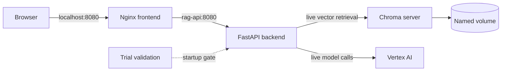

# Local setup and CI

The local runtime follows the course's per-service containers, locked dependencies, Compose networking and
GitHub Actions build/lint/test approach. It does not redeploy the cloud application.

## Start locally

Install Docker with Compose v2 and make, then start Docker. From a clean checkout:

```bash
make up
```

No `.env`, Google credentials, host Python or Node installation is needed for
offline mode. The committed processed trials, patient files and manifest supply
the demo. The first build needs internet access for images and packages.



| Service | Address / responsibility | Startup condition |
| --- | --- | --- |
| `trial-processing` | Validate processed files and checksums; exit successfully | None |
| `rag-chromadb` | Internal `rag-chromadb:8000`; vectors in `rag-chroma-data:/data` | Heartbeat health check |
| `rag-api` | Internal port 8080; host `localhost:8081` | Data validation completed and Chroma healthy |
| `frontend` | `localhost:8080`; static page and API proxy | API healthy |

The browser sends relative URLs to Nginx, which forwards API requests to
`rag-api:8080` using Docker DNS. Chroma has no host port. Host ports bind to
127.0.0.1; override `APP_PORT` and `API_PORT` if already occupied.

```bash
APP_PORT=8090 API_PORT=8091 make up
```

The API's `/health` checks mode and input data; `/ready` checks configured data/index
readiness. Neither proves that a cloud model call will succeed. Offline screening
uses BM25 and rules, while `make live` retains Gemini and trained-encoder retrieval.
Follow the root README's credential setup for that mode. Offline CI does not test
paid model calls or measure model quality.

The DVC snapshot recovery test lives in `cloud/tests/test_dvc_snapshot.py` and runs
in the pipeline job's locked environment, which includes DVC and Git. It restores
an older snapshot from a temporary local remote without cloud credentials.

## Code, dependencies and persistence

- Python services each have their own Dockerfile, `pyproject.toml` and `uv.lock`.
- Nginx copies only frontend assets and its proxy configuration. The frontend's
  test target installs Playwright from its own `package-lock.json` with `npm ci`.
- The API runtime target has Python backend code only. Its `test` target adds
  locked pytest/coverage/Ruff dependencies. The existing Cloud Run build explicitly selects
  `standalone`, which includes the page for that deployment's single-service setup.
- Local Compose mounts source read-only. Uvicorn reloads Python changes; refresh
  the page after editing static assets. Dependency or deployment changes require
  rebuilding the affected image. `docker compose build rag-api` rebuilds only it.
- Chroma's named volume survives `make down`. Do not add `--volumes` if keeping
  local indexes. CI removes only its own disposable project volume at cleanup.
- Processed inputs remain in `services/`; generated output is ignored in `artifacts/`.
  Credentials stay in ignored `secrets/`, mounted read-only and excluded from images.
- Make passes the host UID/GID to Python/test containers so Linux CI reports remain
  writable. It creates required output directories automatically. DVC retains a
  known home/user and a writable cache even when the host UID has no container
  password-file entry, as on macOS.

## Tests and CI

Development checks require uv as well as Docker and make. Install the hook once:

```bash
make hooks
```

The hook checks private keys, credential file paths, YAML/TOML syntax, merge
markers and service lockfile consistency. Application changes also trigger Ruff
lint, Python and frontend format checks, and pytest with the coverage gate. Existing unittest
test cases run through pytest without rewriting their assertions. The hook allows
older branches without this configuration, including the frozen MS3 branch.

```bash
make lint         # Ruff correctness checks, shell syntax and Compose validation
make fmt          # Format maintained Python and frontend source
make format-check # Check formatting without editing files
make check        # Lint, format check and pytest with coverage
make pre-commit   # Run all hooks against tracked files
make coverage     # Backend/API tests; fail below 50% or on any test failure
make up
make system-test  # Verify persistence, index switching and rollback with HTTP Chroma
make e2e          # Chromium -> frontend -> actual offline backend
make ci           # Build, pre-commit checks, startup, persistence and browser tests
make down         # Keep the local vector database
```

Formatting uses Ruff for maintained Python and Prettier for HTML, CSS and JavaScript.
Hash-pinned evaluation files remain byte-for-byte frozen. To apply frontend
formatting with `make fmt`, first run `npm ci --prefix docker/frontend` (Node required
only for editing); format checks run inside Docker.

The coverage script can also be called directly:
`bash scripts/ms4/check_coverage.sh`. It now builds its test image with locked tools
and writes reports even if a test fails. Coverage includes all Python source in
`services/rag_workflow/` and `services/frontend/`, excluding their tests. Browser JS
and unrelated training/pipeline code are outside this denominator.

The browser suite covers patient selection, a real screening request, returned
trial IDs, criterion details, JSON evidence review, empty input and proxied API
validation errors. Success and human-review cases call the real API; empty-response,
provider-failure, timeout and cancellation cases intercept `/screen` to test UI
behavior under controlled failures. The Chroma test uses a reserved test
collection and removes that collection after verification, preserving other indexes.
It also verifies index switching, failed-switch recovery and rollback through
`scripts/ms4/check_index_switch.py`, with fake encoders and disposable test collections.

| Output under `artifacts/ms4/` | Contents |
| --- | --- |
| `coverage.xml`, `coverage_html/index.html`, `coverage.txt` | Backend line coverage |
| `backend-tests.txt`, `frontend-api-tests.txt` | Python test results |
| `backend-tests.xml`, `frontend-api-tests.xml` | Pytest JUnit reports |
| `playwright-report/index.html`, `browser-results.xml` | Browser test results |
| `browser-results/` | Failure screenshots and traces |
| `screening.png` | Successful browser flow screenshot |
| `ci.log` | Complete application build and test output |
| `containers.txt`, `containers.log` | Service status and logs, collected by CI |

`.github/workflows/pipeline-checks.yml` runs on pushes and pull requests. The
`application` job executes `make ci`, including the same pre-commit checks, uploads
reports even on failure, then cleans up. The existing `pipeline` and
`retrieval-runtime` jobs also run their suites through pytest. `pipeline` includes
`services/patient_processing/tests/`; `retrieval-runtime` includes
`evaluation/retrieval/test_benchmark.py`. Their results appear as separate test steps
in Actions. No GCP secrets are
required and no deployment is triggered. A failed check makes the workflow red;
requiring green checks before merging is a separate GitHub branch protection setting.

## Adding tests

- The page is at port 8080, API at 8081; add browser cases under `services/frontend/e2e/`.
- Index integration: Chroma service name/volume above; keep model collections separate. Index
  unit tests in the backend test directory are discovered by the coverage command.
- Add API integration cases under `services/rag_workflow/tests/` or
  `services/frontend/tests/`; the existing suites run automatically.
- Take the coverage/browser reports and CI run link for Test Documentation.
  Use reports from the same commit as the submitted code; saved reports from an
  earlier commit do not verify later changes.

## Troubleshooting

- Docker connection error: start Docker Desktop and retry.
- Port occupied: choose unused `APP_PORT`/`API_PORT` values as above.
- Startup failure: inspect `docker compose ps -a` and `docker compose logs`.
- Dependency edit: update that service's lockfile and rebuild its image.
- Model/index error in live mode: inspect `/ready` and the API logs; confirm the
  README's credentials and model access. Offline tests cannot verify these permissions.
