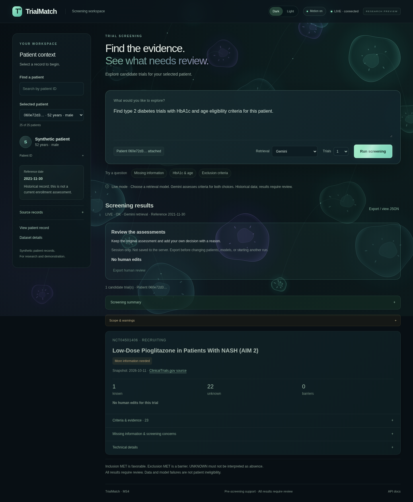
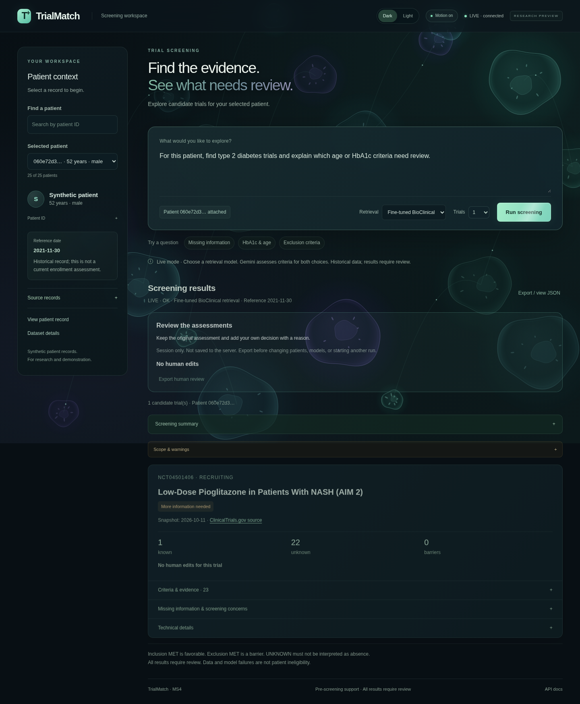
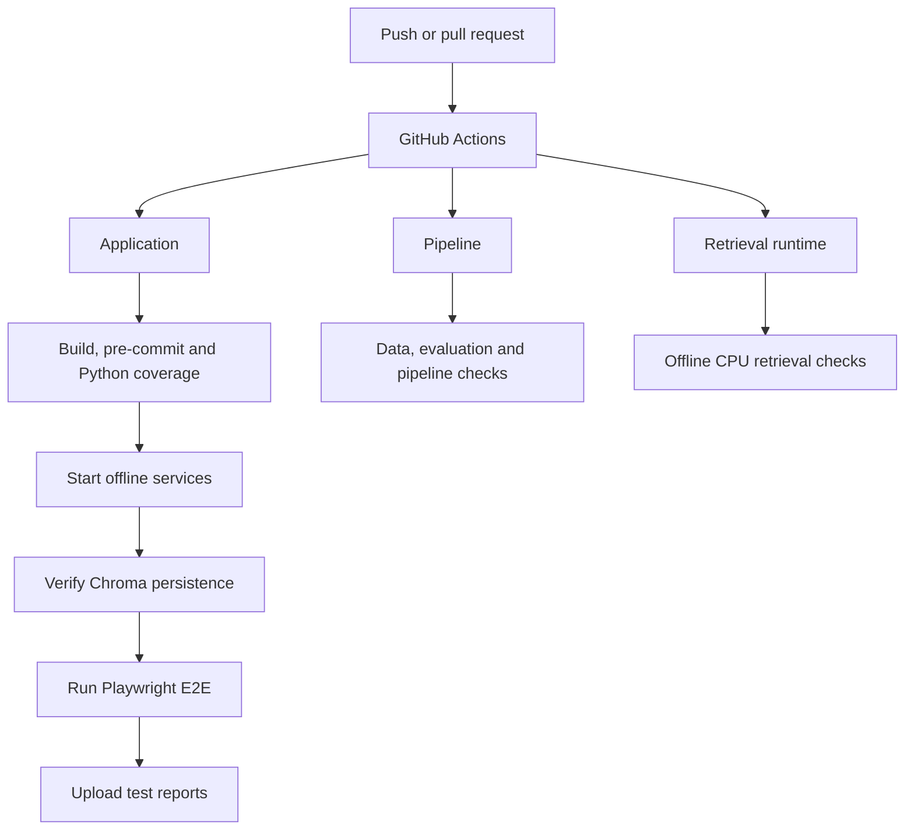

# TrialMatch — Test Documentation

**Team:** Orange Chicken  
**Milestone:** MS4  
**Integration verified:** November 27, 2026. Local results and remote CI evidence are listed below.

## 1. Testing approach

TrialMatch uses automated tests at the component, API, system, and browser levels. The checks focus on reproducible screening, input integrity, evidence traceability, error handling, and a working browser-to-backend path. The application uses synthetic patient records and historical trial data; passing software tests does not establish clinical eligibility or model accuracy.

| Layer | Coverage | Tools and location |
| --- | --- | --- |
| Component | Evidence rules, retrieval, assessment aggregation, embedding interfaces, index snapshots | `pytest` / `unittest`; `services/rag_workflow/tests/` |
| API integration | Request validation, HTTP errors, readiness, offline screening and returned evidence | FastAPI `TestClient`; `services/rag_workflow/tests/`, `services/frontend/tests/` |
| System | Invalid source records, multi-patient provenance, Chroma persistence, index switching and rollback | `test_ms4_system_validation.py`, `test_ms4_provenance.py`, `make system-test` |
| Browser E2E | Real Chromium → Nginx → FastAPI screening, evidence inspection and input errors | Playwright; `services/frontend/e2e/` |
| CI regression | Container startup, lint/format, Python coverage, pipeline checks and retrieval runtime | `.github/workflows/pipeline-checks.yml` |

The configured Python coverage gate is **50%** (`COVERAGE_MIN=50`). Any test failure or coverage below this threshold fails the relevant check.

## 2. Test matrix

The matrix maps acceptance conditions to automated checks in the integrated code. A row denotes a **test area**, not a separate test count.

| Level / area | Acceptance condition | Automated test or command | Result |
| --- | --- | --- | --- |
| Unit — screening rules | Criteria with supported evidence are assessed consistently; unsupported information remains `UNKNOWN` | `test_evidence_rules.py`, `test_evidence_support.py` | Passed |
| Unit — retrieval and index | Embedding interfaces, snapshot identities, checksums and restoration reject incompatible or corrupted data | `test_embedding_providers.py`, `test_index_versions.py` | Passed |
| Unit — patient processing | FHIR normalization preserves source links and handles reference dates, missing values and unresolved medications | `services/patient_processing/tests/test_process_patients.py` | 6 passed |
| Unit — retrieval metrics | Known ranks, duplicate fragments, empty labels and rank-fusion ties produce the expected metrics | `evaluation/retrieval/test_benchmark.py` | 3 passed |
| Integration — API | Invalid inputs, missing patients, dependency failures and readiness states produce appropriate HTTP responses | `test_api_operations.py`, `test_application.py` | Passed |
| Integration — screening | Offline retrieval returns criterion assessments and consistent status/response fields | `test_workflow.py`, `test_grounding_case.py` | Passed |
| System — source integrity | Duplicate trial/patient/criterion IDs and orphan criteria are rejected | `test_ms4_system_validation.py` (SV-01) | Passed |
| System — provenance | Selected patient, trial, criterion and evidence references agree with the source records | `test_ms4_provenance.py` (SV-02) | Passed |
| System — vector persistence | A Chroma test collection remains queryable after container recreation | `make system-test` | Passed |
| E2E — browser/API | Chromium screens patients, inspects evidence, edits/exports reviews and handles empty/error/cancel/timeout states | `services/frontend/e2e/` | 13 passed |
| Pipeline regression | Versioned data, pipeline regressions and frozen evaluations pass offline checks | Same test suites as the Actions `pipeline` job | Passed locally |
| Retrieval runtime | CPU retrieval and checkpoint interfaces pass without model-service calls | Same suite as the Actions `retrieval-runtime` job | Passed locally |

Index tests additionally cover failed builds, model/version isolation, rollback and
malformed selection records. API regressions verify that readiness follows a
switch/rollback without restarting and returns 503 for an invalid selection record.
The HTTP Chroma cycle is included in `make system-test`.

### System-validation cases

**SV-01 — Source-data integrity.** `test_ms4_system_validation.py` constructs temporary JSONL files and verifies that `DataStore` raises `ValueError` for four mutations: duplicate `trial_id`, duplicate `patient_id`, duplicate `criterion_id`, and a criterion referencing a nonexistent trial. All four `unittest.subTest` scenarios passed; pytest reports them as **one collected test**.

**SV-02 — Multi-patient provenance.** `test_ms4_provenance.py` screens the three manifest demo patients in offline mode with `top_k=2`. For each returned trial, it checks patient identity/reference date, source SHA-256 mapping, trial membership/snapshot date, the complete original criterion-ID set and criterion text/type, and evidence/context fact IDs belonging to that patient. All three patient scenarios passed; pytest reports them as **one collected test**. This is a six-result-position referential-integrity sample, not a clinical accuracy evaluation.

## 3. Execution and results

The integrated checks cover the frontend, screening API, index switching,
data preparation and evaluation tools. Local verification uses `make ci` plus
the pipeline and CPU retrieval suites from GitHub Actions.

| Check | Local result |
| --- | --- |
| Backend / frontend Python tests | 116 + 4 passed; 0 failures, 0 skipped |
| Combined Python statement coverage | **86.88%** (1762 / 2028); threshold 50% |
| Browser E2E through Nginx and FastAPI | **13 passed** |
| Chroma persistence and HTTP index switching | Passed; failed switches preserved the active index and rollback made no encoder calls |
| Pipeline, frozen evaluation and patient-processing suites | 150 passed |
| CPU retrieval/checkpoint and retrieval utility suites | 17 passed |
| Build, lint, format and dependency-lock checks | Passed |

Coverage includes Python source in `services/rag_workflow/` and `services/frontend/`,
excluding tests. It does not measure browser JavaScript, cloud training code or model
quality. Test counts across the last two suites overlap in shared retrieval tests;
they are not an additive repository-wide count.

Reports are generated under ignored `artifacts/ms4/`; CI uploads them as
`ms4-application-reports`. For remote verification, open
[this branch's Actions runs](https://github.com/liujiaxi0301/TrialMatch/actions?query=branch%3Ayixiao%2Fms4-infra)
and select the run matching the commit being reviewed. The `application`, `pipeline`
and `retrieval-runtime` jobs must all pass. Patient-processing and retrieval-metric
tests have separate steps with counts in the logs. CI does not redeploy the cloud app.

### Local live demo

Verified on **November 27, 2026, 22:40–22:41 ET**, after `make live` restored the
Gemini snapshot and prepared the trained encoder's separate index. Chromium called
the actual Nginx frontend and FastAPI backend; no responses were mocked.

Both checks selected synthetic patient `060e72d3-912e-55cd-0c92-5faa6cb7a6db`
and requested one trial. The browser displayed candidate criteria and patient
evidence, exported the response, and added/exported/restored a human review without
JavaScript errors.

| Observed value | Gemini retrieval | Fine-tuned BioClinical retrieval |
| --- | --- | --- |
| HTTP / response status | 200 / `OK` | 200 / `OK` |
| Run ID | `e16f55f53bc643ea9c49812bcace9802` | `7b10869ca962401fba8db1c6f55ca1e4` |
| Encoder | `gemini-embedding-001` | `BioClinical-ModernBERT-base`, evaluated November 10 checkpoint |
| Fresh embedding calls | 1 Vertex request | 1 local CPU request |
| Fresh Gemini assessment calls | 5 | 6 |
| Cached assessment calls | 0 | 0 |
| Reported latency | 16.695 s | 17.202 s |
| Returned trial | `NCT04501406` | `NCT04501406` |
| Criterion outcomes | 1 known, 22 `UNKNOWN` | 1 known, 22 `UNKNOWN` |

The Gemini question was “Find type 2 diabetes trials with HbA1c and age eligibility
criteria for this patient.” The trained-model question was “For this patient, find
type 2 diabetes trials and explain which age or HbA1c criteria need review.” Different
questions avoided cached judgments; these timings are functional observations,
not a controlled comparison of model speed or accuracy. Both choices still use
`gemini-3.1-flash-lite` for model-based assessment. The trained response reports
checkpoint SHA-256 `7dcec7d9c8ca3697ee60091346723130ebb37263254e81a69a0aff038dbc931c`.



*Gemini retrieval: the live browser displays the actual screening response.*



*Trained retrieval: the selected model and returned model identity agree.*

The screenshots preserve the actual “More information needed” outcome. Successful
integration does not resolve missing patient evidence: 22 of 23 criteria remained
`UNKNOWN` in each response. Raw local responses and verification output remain in
ignored `artifacts/ms4/live/`; the repository keeps these selected demo screenshots.

### CI verification path



## 4. Reproduction

**Requirements:** Docker with Compose v2 and `make`. Local `make ci` additionally requires `uv`. Offline tests do not require Google Cloud credentials; the initial image build requires network access.

From the repository root:

```bash
make coverage      # Python tests, coverage report and 50% gate
make up            # Start the offline application at localhost:8080
make system-test   # Test Chroma persistence across restart
make e2e           # Chromium browser-to-API tests
make down          # Stop services and preserve the Chroma volume
```

Use `make lint` and `make format-check` for code checks, or `make ci` for the broader build, pre-commit, startup, persistence and browser sequence. Coverage reports are written to `artifacts/ms4/` (`coverage.txt`, `coverage.xml`, `coverage_html/`, JUnit results). See [Infrastructure](INFRASTRUCTURE.md) for service configuration and troubleshooting.

To run the standalone patient-processing and retrieval-metric tests with their CI
environments, install `uv` and run:

```bash
uv run --project docker/workflow --locked python -m pytest -ra --import-mode=importlib services/patient_processing/tests
uv run --project docker/retrieval --locked python -m pytest -ra --import-mode=importlib evaluation/retrieval/test_benchmark.py
```

A manual smoke check follows the same user journey: select a synthetic patient, enter a type 2 diabetes screening question, run screening, expand criterion/evidence details, and inspect the response JSON. An empty question should display a validation message without submitting a screening request.

## 5. Scope and limitations

The CI workflow covers the application Python suites, 13 browser tests, Chroma persistence/switching, patient processing, pipeline/evaluation suites, retrieval runtime and retrieval metrics. Browser success and human-review cases call the actual local API. Failure cases deliberately intercept `/screen`; they verify UI behavior rather than an actual provider outage.

- Automated browser tests exercise the **offline** application; they do not prove Gemini/Vertex permissions, live model responses or cloud deployment availability.
- The separate live demo above verifies both local model choices with one patient and one candidate each. It is not an exhaustive model-quality or cloud-availability test.
- The provenance test checks three synthetic patients and two returned trials per patient; the corruption test checks four defined mutations. Neither is exhaustive fuzzing or clinical validation.
- The dataset consists of synthetic patients dated **2021-11-30** and trial snapshots dated **2026-10-11**. Screening results require human review and are not current enrollment decisions.
- `UNKNOWN` means insufficient support, not a negative criterion assessment; match scores are not enrollment probabilities.

Repeat these commands after subsequent integration changes; old reports do not verify new code.
