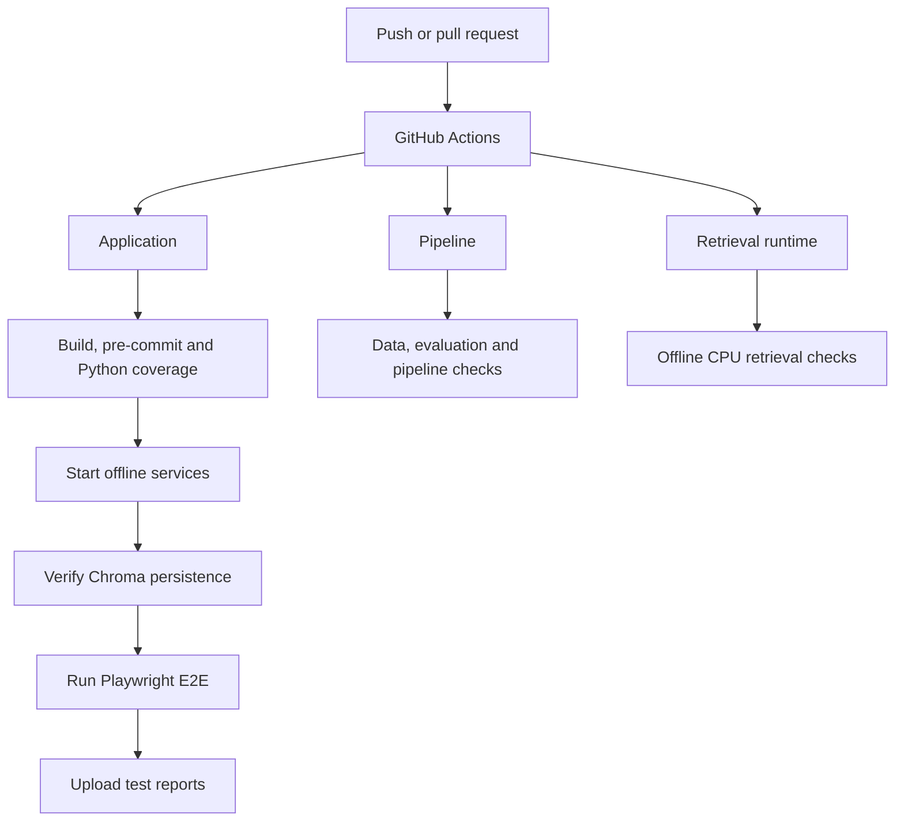

# TrialMatch — Test Documentation

**Team:** Orange Chicken  
**Milestone:** MS4  
**Verified revision:** [`06ebddd`](https://github.com/liujiaxi0301/TrialMatch/commit/06ebddd46c51524e70116377f895f2e635b98875) · November 26, 2026

## 1. Testing approach

TrialMatch uses automated tests at the component, API, system, and browser levels. The checks focus on reproducible screening, input integrity, evidence traceability, error handling, and a working browser-to-backend path. The application uses synthetic patient records and historical trial data; passing software tests does not establish clinical eligibility or model accuracy.

| Layer | Coverage | Tools and location |
| --- | --- | --- |
| Component | Evidence rules, retrieval, assessment aggregation, embedding interfaces, index snapshots | `pytest` / `unittest`; `services/rag_workflow/tests/` |
| API integration | Request validation, HTTP errors, readiness, offline screening and returned evidence | FastAPI `TestClient`; `services/rag_workflow/tests/`, `services/frontend/tests/` |
| System | Invalid source records, multi-patient provenance, Chroma persistence after container recreation | `test_ms4_system_validation.py`, `test_ms4_provenance.py`, `make system-test` |
| Browser E2E | Real Chromium → Nginx → FastAPI screening, evidence inspection and input errors | Playwright; `services/frontend/e2e/screening.spec.js` |
| CI regression | Container startup, lint/format, Python coverage, pipeline checks and retrieval runtime | `.github/workflows/pipeline-checks.yml` |

The configured Python coverage gate is **50%** (`COVERAGE_MIN=50`). Any test failure or coverage below this threshold fails the relevant check.

## 2. Test matrix

The matrix maps acceptance conditions to automated checks in the verified revision. A row denotes a **test area**, not a separate test count.

| Level / area | Acceptance condition | Automated test or command | Result |
| --- | --- | --- | --- |
| Unit — screening rules | Criteria with supported evidence are assessed consistently; unsupported information remains `UNKNOWN` | `test_evidence_rules.py`, `test_evidence_support.py` | Passed |
| Unit — retrieval and index | Embedding interfaces, snapshot identities, checksums and restoration reject incompatible or corrupted data | `test_embedding_providers.py`, `test_index_versions.py` | Passed |
| Integration — API | Invalid inputs, missing patients, dependency failures and readiness states produce appropriate HTTP responses | `test_api_operations.py`, `test_application.py` | Passed |
| Integration — screening | Offline retrieval returns criterion assessments and consistent status/response fields | `test_workflow.py`, `test_grounding_case.py` | Passed |
| System — source integrity | Duplicate trial/patient/criterion IDs and orphan criteria are rejected | `test_ms4_system_validation.py` (SV-01) | Passed |
| System — provenance | Selected patient, trial, criterion and evidence references agree with the source records | `test_ms4_provenance.py` (SV-02) | Passed |
| System — vector persistence | A Chroma test collection remains queryable after container recreation | `make system-test` | Passed |
| E2E — browser/API | Chromium can select a patient, submit screening, inspect evidence/JSON and display input validation | `services/frontend/e2e/screening.spec.js` | 3 passed |
| CI — data and pipeline | Versioned data, pipeline regressions and frozen evaluations pass offline checks | GitHub Actions `pipeline` job | Passed |
| CI — retrieval runtime | CPU retrieval and checkpoint interfaces pass without model-service calls | GitHub Actions `retrieval-runtime` job | Passed |

### System-validation cases

**SV-01 — Source-data integrity.** `test_ms4_system_validation.py` constructs temporary JSONL files and verifies that `DataStore` raises `ValueError` for four mutations: duplicate `trial_id`, duplicate `patient_id`, duplicate `criterion_id`, and a criterion referencing a nonexistent trial. All four `unittest.subTest` scenarios passed; pytest reports them as **one collected test**.

**SV-02 — Multi-patient provenance.** `test_ms4_provenance.py` screens the three manifest demo patients in offline mode with `top_k=2`. For each returned trial, it checks patient identity/reference date, source SHA-256 mapping, trial membership/snapshot date, the complete original criterion-ID set and criterion text/type, and evidence/context fact IDs belonging to that patient. All three patient scenarios passed; pytest reports them as **one collected test**. This is a six-result-position referential-integrity sample, not a clinical accuracy evaluation.

## 3. Execution and results

The following results correspond to revision `06ebddd`, not to a later integration commit.

| Check | Verified result |
| --- | --- |
| Backend Python tests | **100 passed**, including SV-01 and SV-02 |
| Frontend/API Python tests | **6 passed** |
| Combined application Python suite | **106 passed** |
| API/backend Python statement coverage | **85%** (1,529 / 1,790 statements covered; derived from the same file-level report) |
| Combined application Python statement coverage | **83%** (1,612 / 1,931 statements covered) |
| Coverage gate | **Passed** (required ≥50%) |
| Playwright browser tests | **3 passed** in GitHub Actions |
| Chroma persistence | **Passed** after container recreation |
| GitHub Actions | **All 3 jobs passed**: `application`, `pipeline`, `retrieval-runtime` |

Coverage is measured by `coverage.py` at the Python **statement** level, with tests excluded. The **85% API/backend** figure is calculated from the `services/rag_workflow/` rows in the same report; the configured CI gate evaluates the **83% combined** `services/rag_workflow/` and `services/frontend/` scope. Both exceed the required 50% API/backend threshold. These percentages do **not** measure the full repository, browser JavaScript, or clinical/model accuracy. The GitHub run also passed the configured coverage gate and executed the browser/persistence checks.

**Evidence:** [Successful GitHub Actions run #45912304011](https://github.com/liujiaxi0301/TrialMatch/actions/runs/45912304011); artifact `ms4-application-reports` contains coverage, JUnit, browser and container reports (subject to GitHub artifact retention). The workflow definition is [`.github/workflows/pipeline-checks.yml`](../../.github/workflows/pipeline-checks.yml).

### CI verification path



## 4. Reproduction

**Requirements:** Docker with Compose v2 and `make`. Local `make ci` additionally requires `uv`. Offline tests do not require Google Cloud credentials; the initial image build requires network access.

From the repository root:

```bash
make coverage      # Python tests, coverage report and 50% gate
make up            # Start the offline application at localhost:8080
make system-test   # Test Chroma persistence across restart
make e2e           # Chromium browser-to-API tests
make down          # Stop services and preserve the Chroma volume
```

Use `make lint` and `make format-check` for code checks, or `make ci` for the broader build, pre-commit, startup, persistence and browser sequence. Coverage reports are written to `artifacts/ms4/` (`coverage.txt`, `coverage.xml`, `coverage_html/`, JUnit results). See [Infrastructure](INFRASTRUCTURE.md) for service configuration and troubleshooting.

A manual smoke check follows the same user journey: select a synthetic patient, enter a type 2 diabetes screening question, run screening, expand criterion/evidence details, and inspect the response JSON. An empty question should display a validation message without submitting a screening request.

## 5. Scope and limitations

The CI workflow covers the application Python suites, three browser tests, the configured pipeline/evaluation suite and retrieval runtime. The repository also contains `services/patient_processing/tests/test_process_patients.py`; that standalone suite is **not included in the current CI commands**. Browser tests do not yet explicitly exercise the UI's response to an unavailable backend.

- Automated browser tests exercise the **offline** application; they do not prove Gemini/Vertex permissions, live model responses or cloud deployment availability.
- The provenance test checks three synthetic patients and two returned trials per patient; the corruption test checks four defined mutations. Neither is exhaustive fuzzing or clinical validation.
- The dataset consists of synthetic patients dated **2021-11-30** and trial snapshots dated **2026-10-11**. Screening results require human review and are not current enrollment decisions.
- `UNKNOWN` means insufficient support, not a negative criterion assessment; match scores are not enrollment probabilities.

Results and diagrams in this document describe the explicitly linked, tested revision. The same verification commands can be rerun for subsequent revisions.
