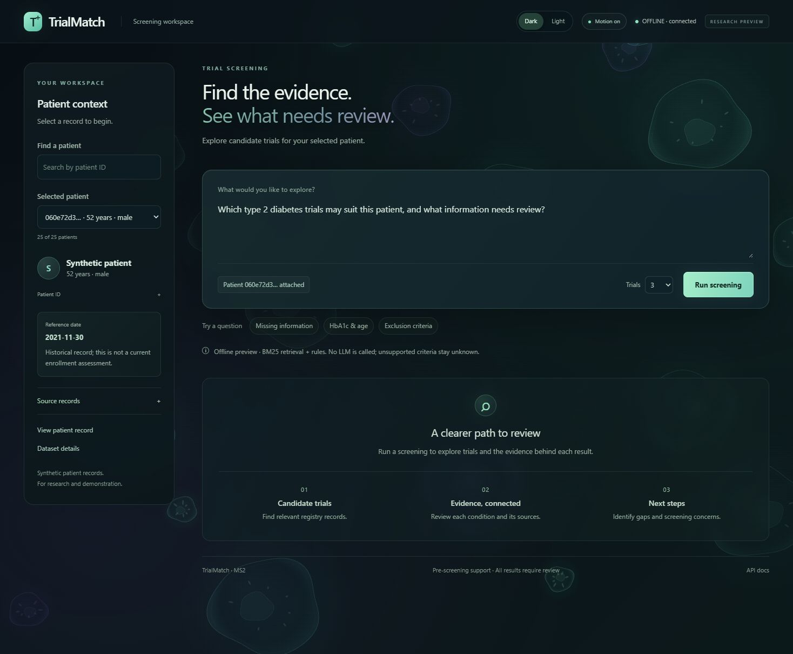
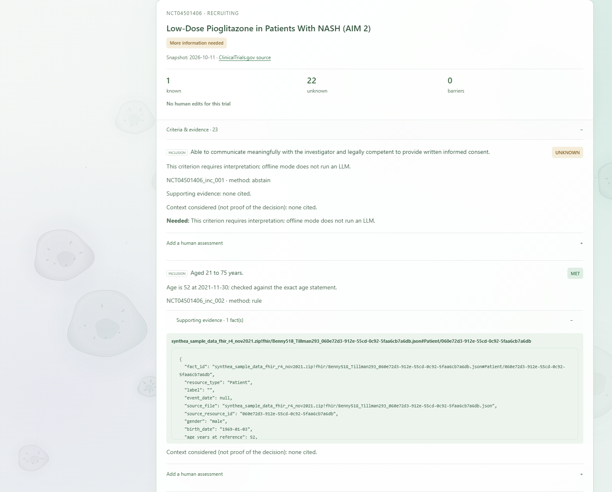

# UI figures for Application Design

These two figures satisfy the UI-materials comment in
`docs/ms4/APPLICATION_DESIGN.md` on `jiaxi/ms4-validation`
at `929913ac2aa36d4f437a42c571adfa91e8f17d4b`.
That document and branch have not been changed here.

## Historical MS2 mock-up

*Original MS2 application mock-up, captured October 20, 2026. The workspace
separates patient selection from the screening question and previews the
candidate-trial, evidence-review and next-step workflow.*

Source: the original `01-patient-and-question.png` in the local
`ms2-mockup-preview` materials; copied without resizing or editing. This is
the historical implemented mock-up, not a new reconstruction or the 344×283
thumbnail.

## Actual MS4 screening result

*Actual MS4 browser-to-API output in local offline mode, captured November 27,
2026. Trial NCT04501406 has its Criteria & evidence and Supporting evidence
sections expanded. The age requirement is 21–75 years; the source patient
record shows age 52 at the 2021-11-30 reference date, and the backend returns
MET. The unsupported consent assessment remains UNKNOWN.*

Capture used the frontend at commit `3c3aefd147016427ec6fd20b1400e14060bc1d4b`
and the actual local Python/FastAPI server at `http://127.0.0.1:8090/`.
The `/screen` response returned HTTP 200 and `result_status: OK`. No API was
intercepted and no human override was applied. This screenshot documents
browser-to-API behavior; it does not document a Docker/Nginx or live-model run.

## Insert into the shared document

Copy the two PNGs into `docs/ms4/images/` on the destination branch. Insert the
two image links and italic captions above near the primary user-flow description
in `APPLICATION_DESIGN.md`, keeping the existing pre-screening figure. Remove
its UI-materials placeholder comment once both images are inserted and their
relative links render on GitHub. This guide is optional handoff context and
does not need to become a separate chapter in the final design document.
